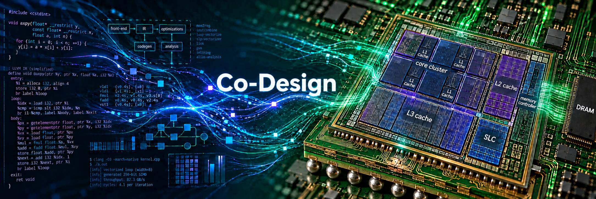

# Software-Hardware Co-Design for Data-Intensive Systems

* homework and labs for " Software-Hardware Co-Design for Data-Intensive Systems (2026 Fall)" in NSYSU, Taiwan

## Projects

Projects | Description
--------|:--------
[Project 1][1]| CSR SpMV: Memory Footprint and Cache Mapping Analysis
[Project 2][2]| CSR SpMV: Profiling Access Locality Impact with Hotspot Analysis and Working Set Sweep
[Project 3][3]| CSR SpMM: Profiling Access Locality Impact with Timing Markers
[Project 4][4]| CSR SpMM: Profiling Access Locality Impact with Hotspot Analysis and Working Set Sweep
[Project 5.1][5_1]| CSR SpMV: DDR4 vs HBM2 Off-chip Memory Access Comparison with Gem5 and Ramulator
[Project 6.1][6_1]| CSR SpMV: AXI4-Stream Compliant Accelerator DDR3 Trace Replay and Row-Buffer Analysis with Ramulator

[1]: projects/project1/
[2]: projects/project2/
[3]: projects/project3/
[4]: projects/project4/
[5_1]: projects/project5_1/
[6_1]: projects/project6_1/

