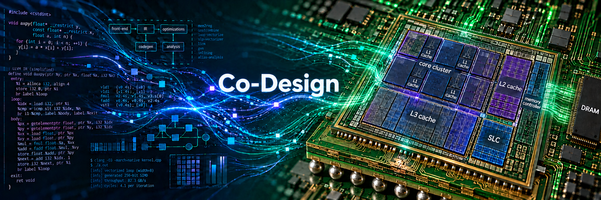

# Software-Hardware Co-Design for Data-Intensive Systems

* homework and labs for " Software-Hardware Co-Design for Data-Intensive Systems (2026 Fall)" in NSYSU, Taiwan

## Labs

Labs | Description
--------|:--------
[W6 Lab][1-1]| CSR SpMV: Profiling the Impact of Memory Access Locality

[1-1]: labs/w6/

## Projects

Projects | Description
--------|:--------
[Project 3][2-3]| CSR SpMM: Profiling Access Locality Impact with Timing Markers
[Project 4][2-4]| CSR SpMM: Profiling Access Locality Impact with Hotspot Analysis and Working Set Sweep

[2-3]: projects/project3/
[2-4]: projects/project4/

