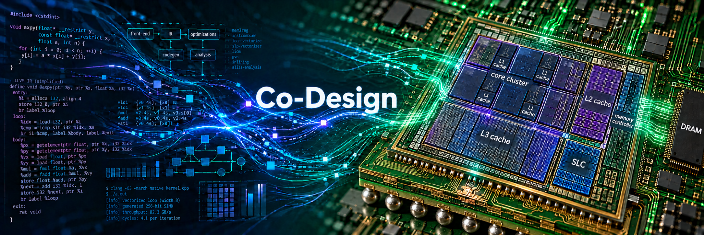

# Software-Hardware Co-Design for Data-Intensive Systems

* homework and labs for " Software-Hardware Co-Design for Data-Intensive Systems (2026 Fall)" in NSYSU, Taiwan

## Projects

Projects | Description
--------|:--------
[W7-1][w7_1]| CSR SpMV: Memory Footprint and Cache Mapping Analysis
[W7-2][w7_2]| CSR SpMM: Profiling Access Locality Impact with Timing Markers
[W8-1][w8_1]| CSR SpMV: Profiling Access Locality Impact with Hotspot Analysis and Working Set Sweep
[W8-2][w8_2]| CSR SpMM: Profiling Access Locality Impact with Hotspot Analysis and Working Set Sweep
[W8][w8]| CSR SpMV: DDR4 vs HBM2 Off-chip Memory Access Comparison with Gem5 and Ramulator
[W9][w9]| CSR SpMV: AXI4-Stream Accelerator DDR3 Trace Replay and Row-Buffer Analysis with Ramulator
[W11-1][w11_1]| Dual-Issue MAC Scheduling with Row Hazards and Bank Conflicts
[W11-2][w11_2]| CSR SpMV: Load Balancing across Three CSR Partitioning Schemes

[w7_1]: projects/w7_1/
[w7_2]: projects/w7_2/
[w8_1]: projects/w8_1/
[w8_2]: projects/w8_2/
[w8]: projects/w8/
[w9]: projects/w9/
[w11_1]: projects/w11_1/
[w11_2]: projects/w11_2/

