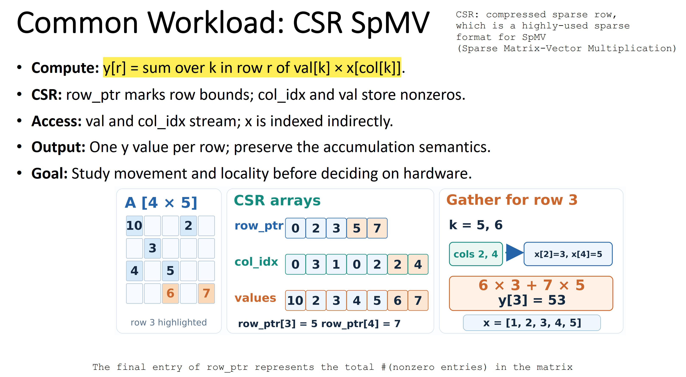

# Project 1. CSR SpMV: Memory Footprint and Cache Mapping Analysis

## 1. Introduction

This project studies the memory behavior of compressed sparse row (CSR) sparse
matrix-vector multiplication using the supplied C++ benchmark. It explains
what `row_ptr`, `column_index`, `values`, `x`, and `y` represent, calculates
the storage required by each array, and quantifies the logical data requested
by one SpMV call.

The main goal is to connect these calculations to cache behavior. The project
uses a small trace to derive block IDs, offsets, sets, and hit/miss outcomes
under direct mapping, then compares those results with an equal-capacity fully
associative cache. This makes it possible to distinguish logical demand from
actual DRAM traffic and to understand how cache reuse and conflicts affect a
data-intensive workload.
PMU measurements are optional because hardware-counter availability is
platform-dependent and is not required to establish the baseline result.

## 2. Reproduction Flow

``` bash
$ bash run.sh
```

`run.sh` builds and verifies the benchmark through
`scripts/verify_benchmark.py`: it compiles with strict warnings, runs the
independent CSR self-test, and checks that local and permuted layouts produce
the same checksum. It then runs identical workloads for the local and
permuted layouts (`65536` rows, `8` nonzeros per row, `500` iterations),
logging the verifier and benchmark output under `logs/`. Add `--pmu` when
hardware counters are useful and available; PMU availability is reported as a
status and is not required for correctness.

## 3. Workload



The workload is a compressed sparse row (CSR) sparse matrix-vector
multiplication. In [SpMV_Guided_Benchmark.cpp](src/SpMV_Guided_Benchmark.cpp),
`row_ptr` identifies the start and end of each matrix row, while
`column_index` and `values` store the nonzero entries. The function
`csr_spmv` accumulates one output value in `sum` for each `row`:

$$
\begin{aligned}
\text{for } row &= 0,\ldots,\texttt{row\_ptr.size()}-2, \\
\texttt{sum} &= \sum_{k=\texttt{row\_ptr}[row]}^{\texttt{row\_ptr}[row+1]-1}
    \texttt{values}[k] \times \texttt{x}[\texttt{column\_index}[k]], \\
\texttt{y}[row] &= \texttt{sum}.
\end{aligned}
$$

The source-code loop therefore performs the equivalent update
`sum += values[k] * x[column_index[k]]` for every stored nonzero. In the
illustrated row 3 example, the nonzeros are `6` and `7` in columns `2` and
`4`, so the computation is

$$
\texttt{y[3]} = 6 \times \texttt{x[2]} + 7 \times \texttt{x[4]}
              = 6 \times 3 + 7 \times 5 = 53,
\qquad \texttt{x} = [1,2,3,4,5].
$$

During setup, `rows` determines the number of outputs in `y`, `column_count`
determines the length of `x`, and `nnz_per_row` determines the fixed row
width. Thus `nonzero_count = rows * nnz_per_row`, and `expected` stores an
independent logical-order result used to validate the kernel before and after
the timed loop.

## 4. Memory Model

The benchmark uses a CSR matrix with `R = 65,536` rows, `C = 4R = 262,144`
columns, and exactly eight nonzeros per row. Therefore,
`NNZ = R * 8 = 524,288`. The executable stores `row_ptr` as 64-bit offsets,
`col_idx` as 32-bit indices, and `values`, `x`, and `y` as 64-bit values. The
`expected` array is an additional 64-bit correctness oracle and is not kernel
payload. Sizes below use binary units (`1 KiB = 1,024 bytes`); the logical
access calculation counts every indexed `x` read and must not be labeled as
DRAM traffic.

| Array | Count | Element size | Computation | Bytes |
| --- | ---: | ---: | --- | ---: |
| `row_ptr` | `R + 1 = 65,537` | 8 B | `65,537 * 8` | `524,296` B (`512 KiB + 8 B`) |
| `col_idx` | `NNZ = 524,288` | 4 B | `524,288 * 4` | `2,097,152` B (`2 MiB`) |
| `values` | `NNZ = 524,288` | 8 B | `524,288 * 8` | `4,194,304` B (`4 MiB`) |
| `x` | `C = 262,144` | 8 B | `262,144 * 8` | `2,097,152` B (`2 MiB`) |
| `y` | `R = 65,536` | 8 B | `65,536 * 8` | `524,288` B (`512 KiB`) |
| `expected` | `R = 65,536` | 8 B | `65,536 * 8` | `524,288` B (`512 KiB`) |
| **Total** | **six arrays** | — | **sum of all arrays** | **9,961,480 B (≈9.50 MiB)** |

One complete SpMV call performs `NNZ = 524,288` logical reads from `x`, so its logical `x` demand is
`524,288 * 8 = 4,194,304` bytes (`4 MiB`). This is a logical demand count,
not a claim about the amount of data transferred from DRAM.

## 5. A Cache Mapping Toy Example

Logical request size is not the same as DRAM traffic: caches at each level can
retain data and enable reuse, allowing later requests to be served without
reaching DRAM. The required toy trace, `[0, 1, 8, 9, 0, 8, 1, 9]` repeated
three times, studies this behavior using a simplified single-level cache
access pattern.

Assume element addresses start at `0x1000`. **The assignment's
cache trace uses 4-byte elements, a 16-byte cache line, and a 32-byte
direct-mapped cache; these toy-cache assumptions are independent of the real
benchmark's 8-byte doubles.** Thus there are two cache lines and two resident
slots.
For element index `i`, `address` is the element's byte address, `block_id`
identifies its 16-byte memory block relative to the base address, `offset` is
the element's byte position within that cache line, and `set` identifies the
direct-mapped cache slot to which the block is assigned:

$$
\begin{aligned}
\text{address} &= 0x1000 + 4i, \\
\text{block\_id} &= \left\lfloor\frac{\text{address} - 0x1000}{16}\right\rfloor, \\
\text{offset} &= (\text{address} - 0x1000) \bmod 16, \\
\text{set} &= \text{block\_id} \bmod 2.
\end{aligned}
$$

The absolute memory block IDs are 256 and 258 for relative block IDs 0 and 2;
both map to resident direct-mapped slot 0. `H` and `M` denote hit and miss.
The fully associative comparison has the same two-line capacity and uses LRU
replacement.

| # | Element | Address | Block ID | Offset | Set | Direct mapped | Fully associative |
| ---: | ---: | ---: | ---: | ---: | ---: | :---: | :---: |
| 1 | 0 | `0x1000` | 0 | 0 | 0 | M | M |
| 2 | 1 | `0x1004` | 0 | 4 | 0 | H | H |
| 3 | 8 | `0x1020` | 2 | 0 | 0 | M | M |
| 4 | 9 | `0x1024` | 2 | 4 | 0 | H | H |
| 5 | 0 | `0x1000` | 0 | 0 | 0 | **M** | **H** |
| 6 | 8 | `0x1020` | 2 | 0 | 0 | **M** | **H** |
| 7 | 1 | `0x1004` | 0 | 4 | 0 | **M** | **H** |
| 8 | 9 | `0x1024` | 2 | 4 | 0 | **M** | **H** |
| 9 | 0 | `0x1000` | 0 | 0 | 0 | **M** | **H** |
| 10 | 1 | `0x1004` | 0 | 4 | 0 | H | H |
| 11 | 8 | `0x1020` | 2 | 0 | 0 | **M** | **H** |
| 12 | 9 | `0x1024` | 2 | 4 | 0 | H | H |
| 13 | 0 | `0x1000` | 0 | 0 | 0 | **M** | **H** |
| 14 | 8 | `0x1020` | 2 | 0 | 0 | **M** | **H** |
| 15 | 1 | `0x1004` | 0 | 4 | 0 | **M** | **H** |
| 16 | 9 | `0x1024` | 2 | 4 | 0 | **M** | **H** |
| 17 | 0 | `0x1000` | 0 | 0 | 0 | **M** | **H** |
| 18 | 1 | `0x1004` | 0 | 4 | 0 | H | H |
| 19 | 8 | `0x1020` | 2 | 0 | 0 | **M** | **H** |
| 20 | 9 | `0x1024` | 2 | 4 | 0 | H | H |
| 21 | 0 | `0x1000` | 0 | 0 | 0 | **M** | **H** |
| 22 | 8 | `0x1020` | 2 | 0 | 0 | **M** | **H** |
| 23 | 1 | `0x1004` | 0 | 4 | 0 | **M** | **H** |
| 24 | 9 | `0x1024` | 2 | 4 | 0 | **M** | **H** |

The direct-mapped cache has 6 hits and 18 misses: blocks 0 and 2 continually
evict one another from slot 0. The equal-capacity fully associative cache has
22 hits and 2 compulsory misses because both blocks remain resident after
their first accesses. This illustrates why associativity matters even when
total cache capacity is unchanged.

## 6. Local vs Permuted Layout

The [SpMV_Guided_Benchmark.cpp](src/SpMV_Guided_Benchmark.cpp) file uses the same CSR SpMV
kernel for both layouts. It parses `--pattern local` or `--pattern permuted`,
then creates the vector `x`, the CSR column indices, and an independent
correctness oracle. The shared [di_common.hpp](src/di_common.hpp) file provides
repeatable values and the bijective `scrambled_id` mapping.

For the local layout, each logical column keeps its original physical position:
`physical = logical`. For the permuted layout,
[SpMV_Guided_Benchmark.cpp](src/SpMV_Guided_Benchmark.cpp) stores each logical
value at `physical = scrambled_id(logical, column_count)` and writes that same
physical index into `column_index`. The kernel's indexed load in
[SpMV_Guided_Benchmark.cpp](src/SpMV_Guided_Benchmark.cpp) therefore reads the correct value
in either case, while the physical access pattern differs. The independent
oracle remains in logical order, so both layouts must produce the same result.

For example, with `column_count = 262,144` and logical column `1`,
[di_common.hpp](src/di_common.hpp) maps the permuted layout to physical index
`224,659`. The local layout stores
`deterministic_x(1) = 0.125` at `x[1]`, while the permuted layout stores the
same value at `x[224659]` and records `column_index = 224659`. A kernel access
to that nonzero therefore fetches `0.125` in both layouts, but from different
locations in memory.

Using the same controlled workload for both patterns makes the layout
comparison meaningful. The two layout runs passed the correctness self-test
(`CORRECT=PASS`) and produced exactly the same checksum: `727476.546875`.
Each run used `65,536` rows, `262,144` columns, `524,288` nonzeros, and `500`
iterations, so the measured performance difference comes from the data layout.

| Metric | Local layout | Permuted layout |
| --- | ---: | ---: |
| Setup time (s) | 0.007334 | 0.012222 |
| Timed kernel (s) | 0.197545 | 0.360992 |
| Time per iteration (ms) | 0.395090 | 0.721984 |
| Time per nonzero (ns) | 0.753575 | 1.377076 |
| `x` size (MiB) | 2.000000 | 2.000000 |

The local layout is faster for this workload: its timed kernel takes about
`0.395090 ms` per iteration versus `0.721984 ms` for the permuted layout.
The permuted layout is approximately `1.83x` slower, or `82.74%` slower, and
its time per nonzero increases from `0.753575 ns` to `1.377076 ns`. Since the
checksums match, the layouts preserve the same numerical result; the observed
difference is therefore a performance effect of memory locality and access
behavior rather than a correctness difference. The permuted setup also takes
longer, but setup time is separate from the timed kernel comparison.

## 7. Conclusion

The memory model shows how CSR storage is distributed across `row_ptr`,
`column_index`, `values`, `x`, `y`, and the independent `expected` oracle. The
cache trace then shows why the size of a logical request is not the same as
DRAM traffic: data may be reused in cache, while conflicting blocks may evict
one another even when total cache capacity is unchanged.

The key lesson is that the memory footprint determines which data can remain
resident in the memory hierarchy, while cache capacity, set associativity, and
replacement policy determine which blocks remain resident in the cache. Both
forms of residency can strongly affect performance in a data-intensive system.
For that reason, element widths, array dimensions, cache-line size, mapping
rules, and associativity assumptions should be pinned before benchmark timings
are interpreted.


