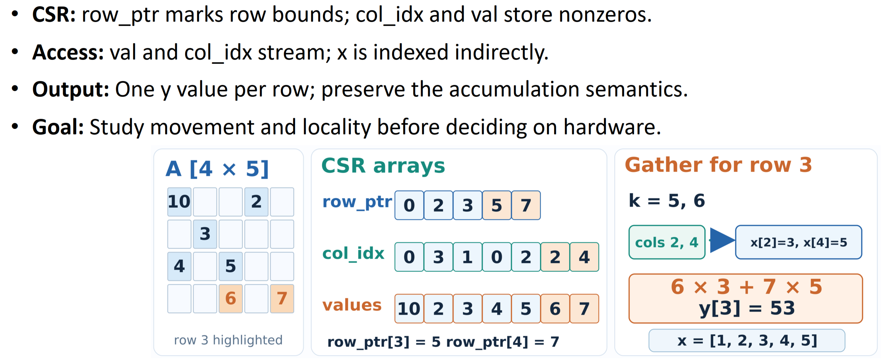
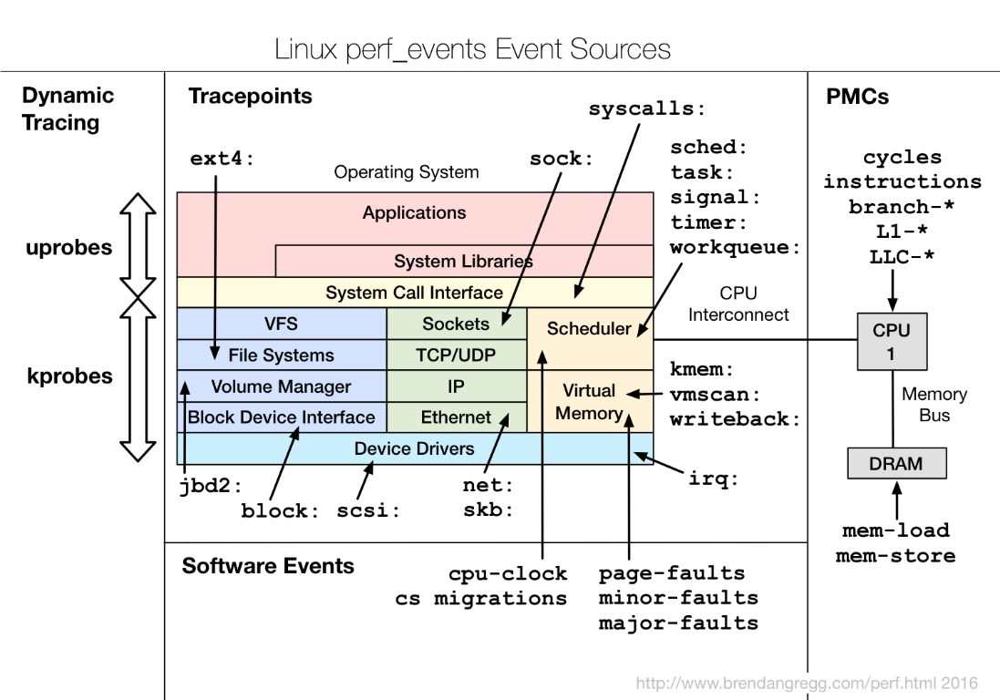
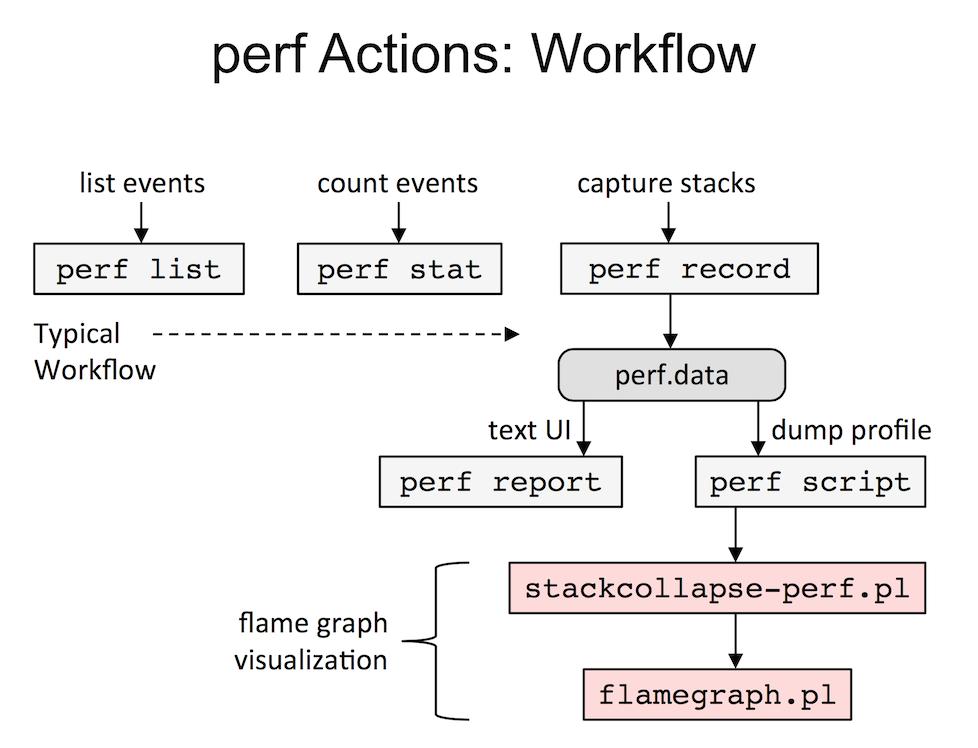
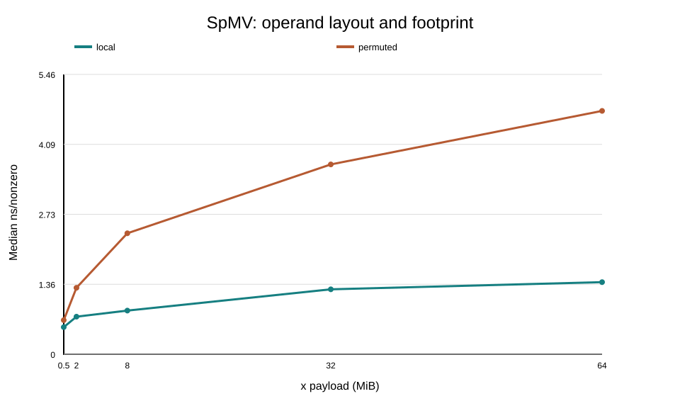

# Project 2. CSR SpMV: Profiling Access Locality Impact with Hotspot Analysis and Working Set Sweep

## 1. Introduction

This project studies how data-access locality affects a compressed sparse row
(CSR) sparse matrix-vector multiplication (SpMV) kernel. The benchmark compares
a `local` layout with a deterministic `permuted` layout while sweeping the
input-vector payload from below one core's L2 cache to beyond the socket-level
last-level cache. Hotspot sampling, elapsed-time measurements, and Linux PMU
counters are used together to connect the observed runtime to the instructions
and cache/TLB events generated by the kernel.

The benchmark is deliberately single-threaded and runs on one logical CPU core.
The goal is therefore not to measure parallel scalability or total machine
bandwidth, but to learn how one core responds when the working set crosses cache
capacity boundaries and when otherwise identical accesses lose locality. The
goal is to understand why the permuted layout is slower and how the cache
and PMU results help explain that difference, without treating any single event
as a direct measure of DRAM traffic.

## 2. Reproduction Flow

```bash
$ bash run.sh
```

The script always performs the following steps in order:

- Collects system and PMU information.
- Builds `src/SpMV_Guided_Benchmark.cpp` into `build/spmv_bench`.
- Runs the benchmark self-test.
- Runs hotspot profiling.
- Runs the smoke test through `scripts/run_SpMV_experiments.py`.
- Runs the full sweep through `scripts/run_SpMV_experiments.py`.
- Generates SVG plots with `scripts/plot_SpMV_results.py`.
- Generates source checksums in `SHA256SUMS.txt`.

## 3. System Information

The script inspects `lscpu`, `/proc/sys/kernel/perf_event_paranoid`, relevant
`perf list` cache and TLB events, and the detailed
`perf list --details cache-misses` output. Each command is written to a
separate log under [`results/0_system_info/`](./results/0_system_info/).

| Field | Value |
| --- | --- |
| Model name | Intel Xeon Gold 6526Y |
| BIOS model name | Intel Xeon Gold 6526Y |
| L1d cache | 1.5 MiB total (48 KiB per core, 32 instances) |
| L2 cache | 64 MiB total (2 MiB per core, 32 instances) |
| L3 cache | 75 MiB (2 instances) |
| NUMA nodes | 2 |
| NUMA node 0 CPUs | 0–15, 32–47 |
| NUMA node 1 CPUs | 16–31, 48–63 |

On Intel Emerald Rapids (Intel's 5th-generation Xeon Scalable server-processor
architecture), the benchmark uses the L2 event
`L2_RQSTS.DEMAND_DATA_RD_MISS`, encoded by the raw value `0x2124`. It counts
true demand data-read misses in the L2 cache and does not count misses that
were merged with other requests.

## 4. Workload

<p align="center"></p>

The workload in this project is **Compressed Sparse Row (CSR) Sparse Matrix-Vector Multiplication (SpMV)**. CSR stores the sparse matrix with row offsets, column indices, and nonzero values. The benchmark executes the kernel in `csr_spmv()` in `src/SpMV_Guided_Benchmark.cpp`.

For each output row, the kernel computes

$$
\mathbf{y} = \mathbf{A}\mathbf{x}, \qquad
y_r = \sum_{k=\mathrm{row\_ptr}[r]}^{\mathrm{row\_ptr}[r+1]-1}
\mathrm{values}[k]\,x_{\mathrm{col\_idx}[k]}.
$$

The sparse matrix $\mathbf{A} \in \mathbb{R}^{R \times C}$ is represented in CSR format, $\mathbf{x} \in \mathbb{R}^{C}$ is the dense input vector, and $\mathbf{y} \in \mathbb{R}^{R}$ is the dense output vector. Each row contains a fixed number of nonzeros in the generated workload.

| Symbol or array | Definition |
| --- | --- |
| $R$ | Number of rows in sparse matrix $A$ |
| $C$ | Number of columns in sparse matrix $A$ and entries in dense vector $x$ |
| $NNZ$ | Number of nonzero entries in $A$ |
| $A$ | Sparse $R \times C$ matrix in CSR format |
| $x$ | Dense input vector with $C$ entries |
| $y$ | Dense output vector with $R$ entries |
| `rp` | `std::size_t` row offsets with $R+1$ entries |
| `ci` | `std::uint32_t` column indices with $NNZ$ entries |
| `v` | `double` nonzero weights with $NNZ$ entries |

The benchmark derives the matrix dimensions from the command-line parameters:

- $C = 4R$ columns.
- $NNZ = R \times$ `nnz-per-row` nonzeros.
- `rows` must be a power of two between 4 and 2,097,152.
- `nnz-per-row` defaults to 8 and may not exceed 1,024.

Two deterministic access layouts are tested:

| Pattern | Definition |
| --- | --- |
| `local` | Logical column indices are used directly, preserving local access order. |
| `permuted` | Logical column indices are mapped through a deterministic bijection before accessing `x`. |

## 5. Project Build

The run script compiles `src/SpMV_Guided_Benchmark.cpp` to produce the `build/spmv_bench` executable.

## 6. Hotspot Analysis

Linux `perf` samples CPU activity and reports where execution time is spent. The
automated workflow profiles the permuted SpMV case and writes the profile and
three command logs to [`results/3_hotspot_analysis/`](./results/3_hotspot_analysis/).

```bash
$ perf record -g -e cycles:u -o results/3_hotspot_analysis/profile.data -- build/spmv_bench --pattern permuted --rows 1048576 --nnz-per-row 8 --iters 60
$ perf report -i results/3_hotspot_analysis/profile.data --stdio
$ perf annotate -i results/3_hotspot_analysis/profile.data --stdio
```

| Command | Purpose |
| --- | --- |
| `perf record` | Collects sampled execution data while the benchmark runs and saves it as a profile. |
| `perf report` | Summarizes the collected profile to show where execution time was spent. |
| `perf annotate` | Associates sampled execution data with source or assembly lines to identify hotspots in detail. |

<p align="center">
    
    
</p>

The first figure shows the kinds of event sources that Linux `perf` can access,
including hardware PMCs. The second shows the command-line workflow used here:
`perf record` collects samples, while `perf report` and `perf annotate` inspect
the resulting profile.

The profile was collected for the entire process using the user-space `cycles:u`
event. It captured 9,115 samples with no lost samples. `main` accounts for 5.11%
of self time and 96.92% of child time, while the `csr_spmv` kernel accounts for
91.68% of self time and 91.65% of child time. The kernel is therefore the primary
hotspot rather than setup or result verification.

The annotated kernel contains the inner accumulation loop
`sum += val[k] * x[ci[k]]`. The floating-point multiply instruction accounts for
78.74% of samples, followed by the indexed `x[ci[k]]` load at 3.95%, loop-bound
comparison at 4.31%, and loop increment at 8.18%. This identifies the multiply
and indirect vector access inside `csr_spmv` as the dominant sampled work.

## 7. Timed Kernel and PMU

### 7.1 Benchmark Timing Markers

The benchmark uses explicit measurement boundaries to define which work is
included in each timing result. `t0` and `t1` surround CSR allocation and
construction, so their difference reports `setup_s`. A second pair of timing
points, `start` and `stop`, surrounds only the repeated `csr_spmv()` loop. That
interval produces `timed_kernel_s`, `ms_per_iter`, and the normalized
`ns_per_nnz` measurement. Correctness warm-up and final verification are outside
this timed kernel interval.

### 7.2 Kernel PMU Implementation

In our implementation, [`SpMV_Guided_Benchmark.cpp`](./src/SpMV_Guided_Benchmark.cpp)
uses `KernelPmu` from [`di_kernel_pmu.hpp`](./src/di_kernel_pmu.hpp) to record
hardware activity during the same interval as the timed SpMV kernel. It starts
the counters immediately before the SpMV loop and stops them immediately
afterward, excluding initialization and correctness checks. Core mode measures
cycles, instructions, generic cache misses, and IPC. Levels mode measures L1D
load misses, L2 demand data-read misses, LLC load misses, and dTLB load misses.
The L2 event is opened only when CPUID identifies Intel Emerald Rapids family 6,
model 207; otherwise it is reported as unavailable.

The two modes are necessary because a CPU has a limited number of hardware PMU
counter slots. Trying to collect every requested event in one group can
overcommit those counters, causing Linux to multiplex events or reducing the
time for which they run. Splitting the events into core and levels groups avoids
that counter-resource overflow and makes each measurement set more reliable.
The experiment runner therefore invokes the modes in separate benchmark
processes rather than collecting them simultaneously.

The implementation uses a **counter group**, which is a set of events opened
together so Linux can start, stop, and read them as one measurement. In
`prepare()`, the selected mode determines which events are requested. Each
`add()` call fills a `perf_event_attr` structure and passes it to the Linux
`perf_event_open` system call. The first successful event becomes the group
leader, and later events join that leader's group through its file descriptor.

At the timing boundary, `ioctl()` resets and enables the complete group before
the loop, then disables it afterward. `read()` retrieves all grouped values,
including the number of events, total time enabled, total time running, and the
individual counter values. These requests are handled by the Linux kernel,
which programs the Intel PMU; the benchmark does not send commands directly to
the CPU. Grouping also makes it possible to determine whether the events were
actually scheduled together and whether multiplexing reduced measurement
coverage.

Both modes report PMU availability and a running fraction for the measured
interval. Missing events are reported explicitly rather than treated as zero,
and a partial result can still be used when only some counters are unavailable.
The PMU values complement the elapsed-time measurements: they describe hardware
activity during the kernel, but they do not by themselves prove that a specific
amount of traffic reached DRAM.

## 8. Experiment

### 8.1 Self Test

The benchmark's built-in `--selftest` mode runs an independent CSR correctness
check and validates the deterministic permutation used by the `permuted`
workload. The automated runner executes it during the self-test step and writes
the output to [`results/2_self_test/self_test.log`](./results/2_self_test/self_test.log).

```bash
$ build/spmv_bench --selftest
SELFTEST=PASS CSR_ORACLE=PASS SCRAMBLE_BIJECTION=PASS
```

The CSR oracle uses the following small matrix-vector problem:

$$
\mathbf{A} =
\begin{bmatrix}
2 & 0 & 0 & 1 \\
0 & -1 & 3 & 0 \\
4 & 0 & 0 & 0
\end{bmatrix},
\qquad
\mathbf{x} =
\begin{bmatrix}
1 \\
2 \\
3 \\
4
\end{bmatrix}.
$$

The CSR representation stores the nonzero values row by row:

```text
val = [2, 1 | -1, 3 | 4]
ci  = [0, 3 |  1, 2 | 0]
rp  = [0, 2, 4, 5]
```

The row pointers divide the nonzeros into three rows. Therefore:

$$
\begin{aligned}
y_0 &= 2x_0 + 1x_3 = 6, \\
y_1 &= -1x_1 + 3x_2 = 7, \\
y_2 &= 4x_0 = 4.
\end{aligned}
$$

Thus, the expected result is:

$$
\mathbf{y} =
\begin{bmatrix}
6 \\
7 \\
4
\end{bmatrix}.
$$

The self test compares every output element with this explicit result, then
checks that `scrambled_id(i, n)` is a bijection for sizes from 16 through
65,536. This verifies CSR traversal, accumulation, and the permutation used by
the permuted layout independently of the generated benchmark workload.

### 8.2 Smoke Test

The smoke test runs a small experiment set to validate the executable, result schema, and plotting path before the full sweep:

```bash
$ python3 scripts/run_SpMV_experiments.py --smoke --reps 1 --out results/4_smoke_test
$ python3 scripts/plot_SpMV_results.py results/4_smoke_test/summary.csv
```

### 8.3 Working-Set Sweep

The full sweep uses five repetitions by default. Set `REPS` to override that value:

```bash
$ REPS=10 ./run.sh
```

```bash
$ python3 scripts/run_SpMV_experiments.py --reps 5 --out results/5_full_sweep
$ python3 scripts/plot_SpMV_results.py results/5_full_sweep/summary.csv
```

For each case, the runner starts a separate benchmark process with `--pmu` and
another with `--pmu-levels`, checks that both results are correct and have
matching checksums, and then combines the measurements in the output CSV files.
The two PMU modes run sequentially rather than simultaneously, so the core's
programmable-counter limit is not exceeded. The runner writes one log for each
layout, repetition, and PMU mode to
[`results/5_full_sweep/logs/`](./results/5_full_sweep/logs/), and writes
`raw.csv`, `summary.csv`, provenance, and the SVG plot directly under
[`results/5_full_sweep/`](./results/5_full_sweep/).

The sweep changes the sparse-matrix row count while keeping `nnz-per-row=8` and
$C=4R$. Because each element of the dense input vector $x$ is an 8-byte double,
the input payload is $8C=32R$ bytes. The selected sizes span the per-core L2
and socket-level LLC capacities reported for the target server:

| $R$ | $x$ payload | Reason to include |
| ---: | ---: | --- |
| 16,384 | 0.5 MiB | Smaller than one core's L2 |
| 65,536 | 2 MiB | Near one core's L2 |
| 262,144 | 8 MiB | Beyond L2; below socket LLC |
| 1,048,576 | 32 MiB | Near socket LLC capacity |
| 2,097,152 | 64 MiB | Above socket LLC capacity |

The `local` and `permuted` layouts are both tested at every size. The payload
values describe only the input vector $x$; the CSR arrays, output vector, and
correctness oracle add additional working-set data. The runner uses 400, 300,
100, 40, and 20 timed iterations for the five sizes respectively, with five
repetitions per layout by default.

The L2 event is collected only after the benchmark identifies an Emerald Rapids
CPU, and Linux must also permit access to it. Permissions, kernel support, or
PMU availability may prevent collection; if the L2 event is unavailable, its
result is reported as `N/A`, the experiment continues with any other available
counters, and `PMU_STATUS=PARTIAL` is acceptable when only some fields are
missing. Consult `PMU_UNAVAILABLE_EVENTS` for failure details and record the
CPU model. For meaningful comparisons, report per-iteration or per-nonzero
normalized counts within the same PMU mode, since different layouts can
reverse rankings at individual cache levels.

## 9. Experiment Result

<p align="center"></p>

The plot shows the median normalized kernel time from the full working-set sweep.
The horizontal axis is the input-vector payload, and the vertical axis is
median nanoseconds per nonzero. The table below keeps the measurements most
relevant to the working-set and locality analysis. PMU counts are medians from
the corresponding five repetitions; all rows passed correctness and had five
successful core and levels PMU passes.

### 9.1 Local layout

| $R$ | $x$ payload | Median ms/iter | Median ns/nonzero | Median IPC | L1D load misses | L2 demand-read misses | LLC load misses | dTLB load misses |
| ---: | ---: | ---: | ---: | ---: | ---: | ---: | ---: | ---: |
| 16,384 | 0.5 MiB | 0.07 | 0.53 | 4.20 | 3,342,792 | 27,973 | 0 | 0 |
| 65,536 | 2 MiB | 0.38 | 0.73 | 3.03 | 8,008,429 | 56,810 | 11 | 14 |
| 262,144 | 8 MiB | 1.79 | 0.85 | 2.62 | 8,714,371 | 40,195 | 426,525 | 447 |
| 1,048,576 | 32 MiB | 10.62 | 1.27 | 1.75 | 10,988,033 | 53,125 | 4,601,925 | 245 |
| 2,097,152 | 64 MiB | 23.60 | 1.41 | 1.58 | 10,476,474 | 57,985 | 5,831,429 | 157 |

For the local layout, median ns/nonzero rises from 0.53 at 0.5 MiB to 1.41 at
64 MiB, a 2.70x increase. The increase is gradual: performance remains below
0.90 ns/nonzero through the 8 MiB case, then rises to 1.27 and 1.41 ns/nonzero
as the payload approaches and exceeds socket LLC capacity. IPC decreases from
4.20 to 1.58 across the same range, while L1D load misses remain between
roughly 3.34 and 10.99 million. This is the expected
behavior for the layout that preserves local access order as the input payload
moves through the cache hierarchy.

### 9.2 Permuted layout

| $R$ | $x$ payload | Median ms/iter | Median ns/nonzero | Median IPC | L1D load misses | L2 demand-read misses | LLC load misses | dTLB load misses |
| ---: | ---: | ---: | ---: | ---: | ---: | ---: | ---: | ---: |
| 16,384 | 0.5 MiB | 0.09 | 0.67 | 3.34 | 50,227,510 | 21,987 | 0 | 1 |
| 65,536 | 2 MiB | 0.68 | 1.30 | 1.71 | 151,573,233 | 33,708,556 | 84 | 320 |
| 262,144 | 8 MiB | 4.95 | 2.36 | 0.94 | 157,229,227 | 76,778,411 | 4,517,464 | 1,190 |
| 1,048,576 | 32 MiB | 31.06 | 3.70 | 0.60 | 243,254,149 | 144,786,872 | 52,767,638 | 1,004 |
| 2,097,152 | 64 MiB | 79.64 | 4.75 | 0.47 | 220,871,734 | 100,414,079 | 182,387,304 | 4,104 |

For the permuted layout, median ns/nonzero rises from 0.67 at 0.5 MiB to 4.75
at 64 MiB, a 7.14x increase. The sharpest transition is from 2 MiB to 8 MiB,
where the payload moves from near one core's L2 to beyond L2. IPC falls from
3.34 to 0.47, and the L1D load-miss count reaches 243,254,149 at 32 MiB.
At 64 MiB, LLC load misses reach 182,387,304 and dTLB load misses reach
4,104, showing that the irregular access pattern continues to stress lower
cache levels and address translation as the working set grows.

### 9.3 Local vs Permuted Layout

The working-set design uses payloads of 0.5, 2, 8, 32, and 64 MiB. These are,
respectively, below one core's 2 MiB L2, near L2, beyond L2 but below the 75 MiB
socket LLC, near the LLC capacity, and above the LLC capacity. Because
`nnz-per-row=8` remains fixed and only $R$ changes, the sweep isolates the
effect of increasing the input vector's working set while comparing two access
layouts.

At every size, the permuted layout is slower than the local layout. The penalty
grows from 1.26x at 0.5 MiB to 1.77x at 2 MiB, 2.77x at 8 MiB, 2.92x at 32 MiB,
and 3.38x at 64 MiB. This widening separation matches the plot and connects the
layout transformation to the cache-capacity transitions in the sweep-design
table.

The PMU counts support this locality trend, but they are not additive traffic
totals. At 32 MiB, for example, permuted layout records 243,254,149 L1D load
misses, 144,786,872 L2 demand-read misses, and 52,767,638 LLC load misses,
compared with 10,988,033, 53,125, and 4,601,925 for local layout. At 64 MiB,
permuted LLC load misses increase to 182,387,304 while local remains at
5,831,429. These counters should be compared within the
same case and PMU mode, not summed as a DRAM-traffic estimate.

All ten rows in `summary.csv` have `all_correct=True`, `core_pmu_ok_count=5`,
and `levels_pmu_ok_count=5`. The comparisons therefore use valid five-repetition
medians rather than mixing failed runs with successful measurements.

## 10. Conclusion

The sweep shows that preserving access locality keeps the single-threaded SpMV
kernel relatively stable as the input vector grows, while the permuted layout
becomes increasingly expensive once the payload approaches and exceeds the
cache hierarchy. The permuted case has higher normalized time, lower IPC, and
substantially more cache and TLB misses at the larger working-set sizes. The
hotspot profile also confirms that the CSR accumulation loop dominates the
process, so the measured differences are primarily kernel-access effects rather
than setup or verification overhead.

The practical best practice is to keep the benchmark single-threaded and pinned
to one core when studying locality, separate PMU counter modes to avoid counter
oversubscription, normalize runtime by nonzeros, and compare layouts at matched
working-set sizes and repetitions. Use hotspot data to locate the responsible
code, treat PMU counters as clues rather than direct measurements of DRAM
traffic, and validate every result with correctness checks before drawing
architectural conclusions.

