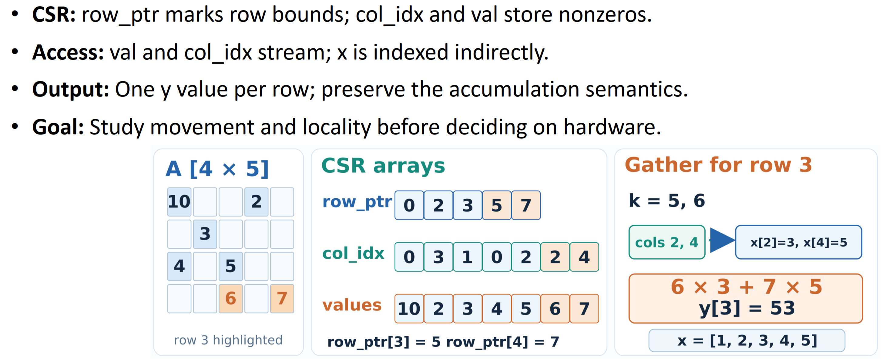
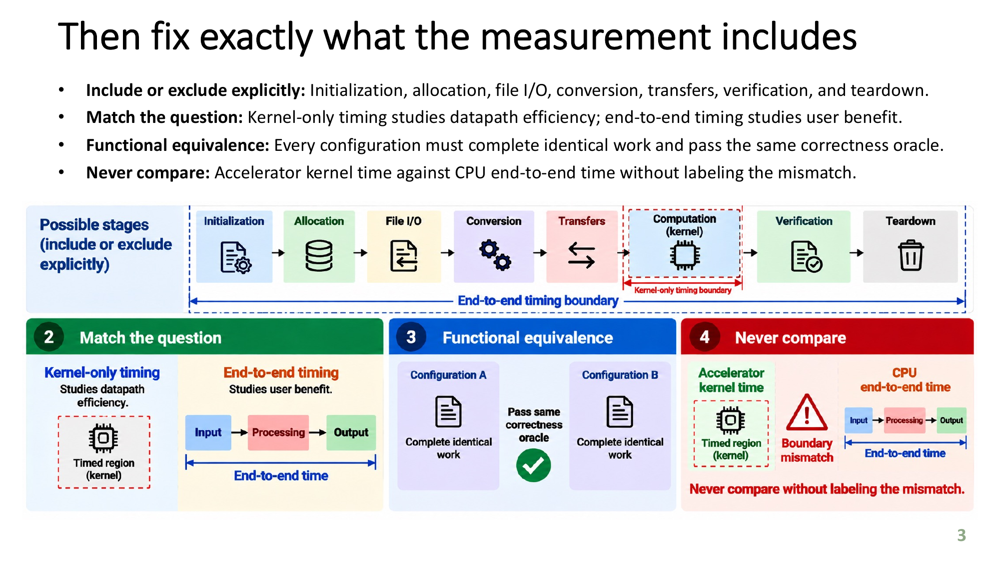
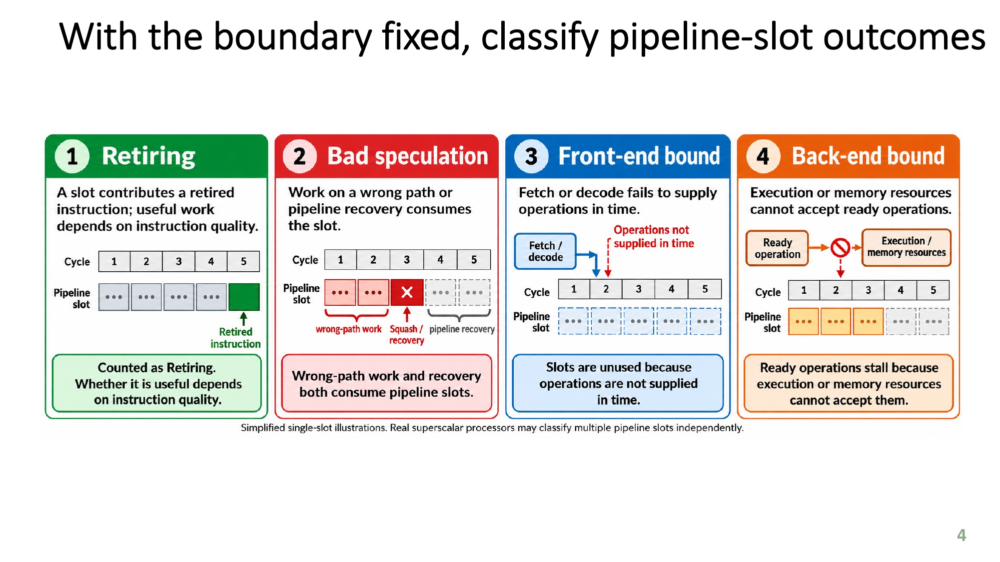
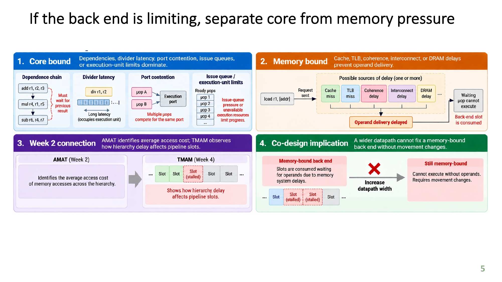

# Project 1: CSR SpMM: Profiling the Impact of Memory Access Locality

## 1. Introduction

Sparse–dense matrix multiplication (SpMM) is commonly used for neighbor aggregation in graph neural networks (GNNs). It combines a sparse adjacency matrix with a dense feature matrix to produce one aggregated feature vector for each output row.

This project studies how memory layout affects the performance of a CSR sparse–dense matrix multiplication (SpMM) workload. It separately measures setup time and repeated kernel execution time using C++ `<chrono>`, while a PMU is also provided but not used in this project.

## 2. Usage

``` bash
$ python3 Verify_Benchmark.py
SELFTEST=PASS
LAYOUT_ORACLE=PASS checksum=386050.195312
VALIDATION=PASS (PMU hardware availability must be checked on target CPU)
```

## 3. Workload

In the function `csr_spmm()` in `SpMM_GNN_Aggregation_Benchmark.cpp`. This project benchmarks the weighted aggregation

$$
\mathbf{Y} = \mathbf{A}\mathbf{X}, \qquad
Y_{r,f} = \sum_{c\, :\, A_{r,c} \ne 0} A_{r,c}X_{c,f},
$$

where $\mathbf{A} \in \mathbb{R}^{R \times C}$ is a sparse matrix stored in Compressed Sparse Row (CSR) format, a common format in many libraries,
$\mathbf{X} \in \mathbb{R}^{C \times F}$ contains input feature vectors, and
$\mathbf{Y} \in \mathbb{R}^{R \times F}$ contains the aggregated output features.
The dense matrices $X$ and $Y$ use row-major storage. Each output feature vector is the weighted sum of its neighbors' input feature vectors.

| Symbol or array | Definition |
| --- | --- |
| $R$ | Number of rows in sparse matrix $A$ |
| $C$ | Number of columns in sparse matrix $A$ and rows in dense matrix $X$ |
| $NNZ$ | Number of nonzero entries in $A$ |
| $F$ | Number of features per row of $X$ and $Y$ |
| $A$ | Sparse $R \times C$ matrix in CSR format |
| $X$ | Dense $C \times F$ row-major feature matrix |
| $Y$ | Dense $R \times F$ row-major output matrix |
| `row_ptr` | `std::size_t` row offsets with $R+1$ entries |
| `col_idx` | `std::uint32_t` column indices with $NNZ$ entries |
| `values` | `double` nonzero weights with $NNZ$ entries |

The benchmark implements this aggregation kernel only; it does not include graph normalization, learned feature transformations, activation functions, or training.

Compressed Sparse Row (CSR) format is a common format used to store sparse matrices in a memory-efficient manner in many libraries.

<p align="center"></p>

## 4. Program Self Test

``` bash
$ ./build/spmm_gnn --selftest
SELFTEST=PASS CSR_SPMM_ORACLE=PASS
```

The self test computes the following small matrix product:

$$
\mathbf{A} =
\begin{bmatrix}
2 & 0 & 0 & 1 \\
0 & -1 & 3 & 0 \\
4 & 0 & 0 & 0
\end{bmatrix},
\qquad
\mathbf{X} =
\begin{bmatrix}
1 & 2 \\
2 & 1 \\
3 & 0 \\
4 & -1
\end{bmatrix}.
$$

The CSR representation stores the nonzero values row by row:

```text
val = [2, 1 | -1, 3 | 4]
ci  = [0, 3 |  1, 2 | 0]
rp  = [0, 2, 4, 5]
```

The row pointers divide the nonzeros into three rows. Therefore:

$$
\begin{aligned}
Y_{0,:} &= 2X_{0,:} + 1X_{3,:} = [6, 3], \\
Y_{1,:} &= -1X_{1,:} + 3X_{2,:} = [7, -1], \\
Y_{2,:} &= 4X_{0,:} = [4, 8].
\end{aligned}
$$

Thus, the expected result is:

$$
\mathbf{Y} =
\begin{bmatrix}
6 & 3 \\
7 & -1 \\
4 & 8
\end{bmatrix}.
$$

The self test compares every output element with this explicit result, checking CSR traversal and accumulation independently of the generated benchmark workload.

## 5. Local vs Permuted Memory Layout

``` bash
$ ./build/spmm_gnn --pattern local --rows 32768 --nnz-per-row 8 --features 32 --iters 100
CORRECT=PASS kernel=SpMM pattern=local rows=32768 ncols=131072 nnz=262144 features=32 iters=100 checksum=6176778.953125
setup_s=0.028128 timed_kernel_s=0.360117 ms_per_iter=3.601173 ns_per_edge_feature=0.429293 feature_table_MiB=32.000000
```

``` bash
$ ./build/spmm_gnn --pattern permuted --rows 32768 --nnz-per-row 8 --features 32 --iters 100
CORRECT=PASS kernel=SpMM pattern=permuted rows=32768 ncols=131072 nnz=262144 features=32 iters=100 checksum=6176778.953125
setup_s=0.048622 timed_kernel_s=0.785908 ms_per_iter=7.859080 ns_per_edge_feature=0.936875 feature_table_MiB=32.000000
```

Both runs differ only in memory access locality. In the `local` layout, logical column IDs are stored in their original order, so neighboring accesses to $X$ are more likely to be close in memory. In the `permuted` layout, the column IDs and corresponding feature rows are deterministically scrambled together; this preserves correctness while reducing access locality. The benchmark times only repeated kernel execution after setup.

| Result | Local | Permuted |
| --- | ---: | ---: |
| Setup time (s) | 0.028128 | 0.048622 |
| Timed kernel (s) | 0.360117 | 0.785908 |
| Time per iteration (ms) | 3.601173 | 7.859080 |
| Time per edge-feature (ns) | 0.429293 | 0.936875 |

## 6. Calculate Memory Footprint for a Test Case

```bash
$ python3 src/memory_footprint.py
```

The test case uses $R = 32768$, $C = 4R = 131072$, $F = 32$, and 8 stored entries per row, so $NNZ = R \times 8 = 262144$.

Each array's footprint is its element count multiplied by its element size:

| Array | Element type | Footprint formula (bytes) | Size |
| --- | --- | --- | --- |
| `row_ptr` | `std::size_t` | $(R + 1) \times 8$ | 0.25 MiB |
| `col_idx` | `std::uint32_t` | $NNZ \times 4$ | 1.00 MiB |
| `values` | `double` | $NNZ \times 8$ | 2.00 MiB |
| `X` | `double` | $C \times F \times 8$ | 32.00 MiB |
| `Y` | `double` | $R \times F \times 8$ | 8.00 MiB |
| `expected` | `double` | $R \times F \times 8$ | 8.00 MiB |
| **Total** | — | sum of the above | **51.25 MiB** |

Here, sizes count array payloads only, excluding vector metadata and allocator overhead.

## 7. Traffic vs Storage

**Storage is the space occupied by the arrays**, independent of how often their elements are accessed. X occupies 32.00 MiB, and the six array payloads total 51.25 MiB, as calculated above. The actual allocation footprint can also include **vector metadata, allocator overhead, and alignment padding**, which the payload calculation excludes.

**Traffic counts data movement during execution.** Each stored entry of A causes the kernel to logically read $F$ consecutive `double` values from X, in both local and permuted layouts. Therefore, one complete `csr_spmm` invocation has logical feature read demand:

The logical read demand is calculated as:

$$
B_{\text{logical feature reads}} = NNZ \times F \times 8
= 262144 \times 32 \times 8
= 67{,}108{,}864 \text{ bytes} = 64 \text{ MiB}.
$$

**Logical read demand is not measured DRAM traffic.** The distinction depends on several effects:

- **Cache hits and reuse:** repeated reads may be served by cache, producing no additional DRAM reads. Data can also remain cached between timed invocations.
- **Cache misses and eviction:** capacity limits and cache conflicts can cause the same data to be fetched from DRAM multiple times.
- **Cache-line granularity and alignment:** memory is fetched in cache-line units, so a transfer can include bytes beyond those requested. Contiguous features help use the fetched bytes.
- **Prefetching:** hardware may fetch data before it is requested, including data that is never used.
- **Other memory accesses and write overhead:** the kernel also reads CSR arrays and writes Y. Depending on the cache policy, output stores can cause write allocation and later dirty-line writebacks. These are absent from the X-only demand formula. The allocated `expected` array is used for validation, rather than read by `csr_spmm`.
- **Synchronization and coherence:** in a parallel implementation, locks, atomics, and cache-line sharing can add communication and execution overhead without changing array sizes. This kernel is single-threaded and has no explicit thread synchronization; cache-to-cache transfers would also need to be distinguished from DRAM transfers.

Both local and permuted layouts have the same storage footprint and logical feature read demand. Their DRAM traffic may differ because their memory access locality differs. Repeated timed invocations may also reuse data already in cache.

## 8. Access Pattern Interpretation 

For one nonzero entry $A_{r,c}$, the kernel reads all $F$ features in the contiguous row $X[c,:]$. With row-major storage, these feature values are adjacent, so one cache-line fetch can serve several accesses. Nearby edges that reference nearby rows of $X$ therefore benefit from better spatial locality in the local layout.

The benefit is not guaranteed. For example, if the feature table and the set of accessed rows are much larger than the cache, or if the permuted access pattern provides little temporal reuse, each row of $X$ may be evicted before it is reused. In that case, most accesses can miss in cache even though the $F$ features within each row are contiguous.

## 9. Propose a Falsifiable Reuse Hypothesis

<p align="center"></p>

**hypothesis:** for the fixed baseline workload, the local layout will have lower kernel time and lower time per edge-feature than the permuted layout because nearby neighbor references reuse cache lines from nearby rows of $x$. the implementation, input, machine state, timed region, correctness checks, and statistical procedure must remain fixed; both layouts must perform identical work and pass the same oracle; and performance evidence must distinguish memory pressure from front-end or core-bound limitations.

**Falsification experiment:** Compile once, then run `local` and `permuted` with identical dimensions, iteration counts, warm-up, timed kernel boundaries, and correctness checks. Repeat each run and compare `ms_per_iter` and `ns_per_edge_feature`. The hypothesis is falsified if repeated measurements show no consistent performance advantage for the local layout. PMU counters, if collected, provide supporting evidence rather than a direct DRAM-traffic measurement.

With the reuse hypothesis and falsifiable experiment defined, we can proceed to optimize the workload while preserving the measurement boundary, functional equivalence, and correctness requirements.

<p align="center">
    
    
    
    
</p>

## 10. Conclusion

The local layout completed the timed kernel in 0.360117 s, compared with 0.785908 s for the permuted layout. This corresponds to 3.601173 ms versus 7.859080 ms per iteration, showing that the permuted accesses substantially worsen performance.

The result supports the hypothesis that memory-access locality affects CSR SpMM performance. As a best practice, future measurements should first run and record a kernel warm-up phase to expose cold-start effects, then discard warm-up samples and report repeated steady-state measurements with variation such as median, minimum, and standard deviation. Setup, validation, and reporting should remain outside the kernel-only timed region, and both layouts must use the same machine state, dimensions, iteration count, and correctness oracle.

For more detailed data, use the built-in PMU support or Linux `perf stat` to collect cycles, instructions, cache-miss events, and related counters over the same timed region. Linux `perf record`/`perf report` or `gprof` can identify where execution time is spent, although profiling instrumentation and counter availability can perturb results. Hardware counters are architecture- and permission-dependent, so their event definitions and availability should be recorded with the machine configuration; cache misses should not be treated as direct DRAM-byte measurements without additional memory-bandwidth evidence.
