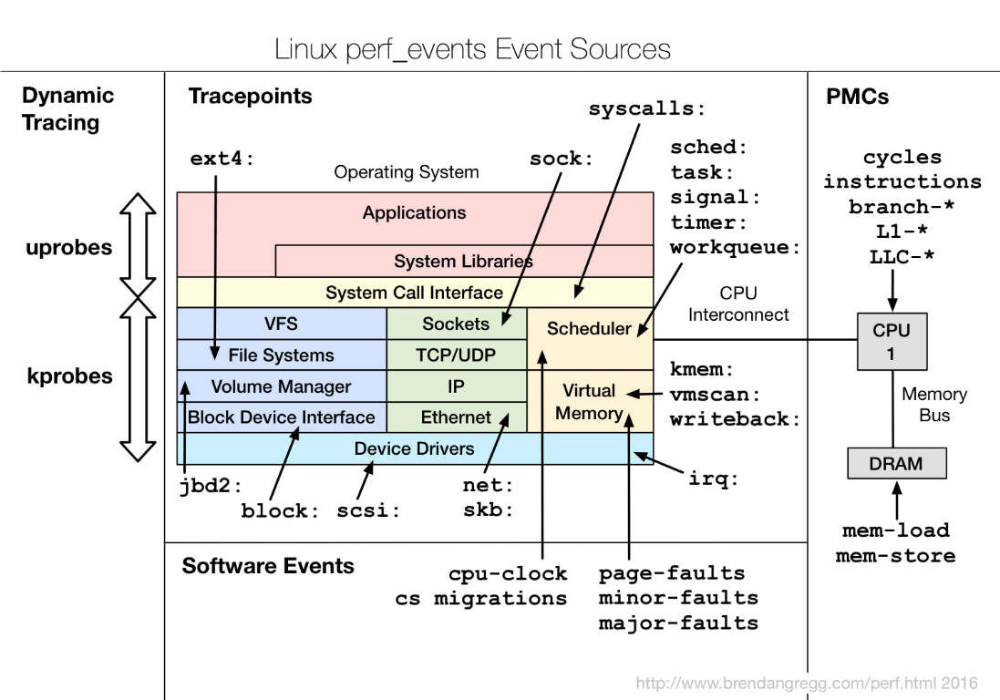
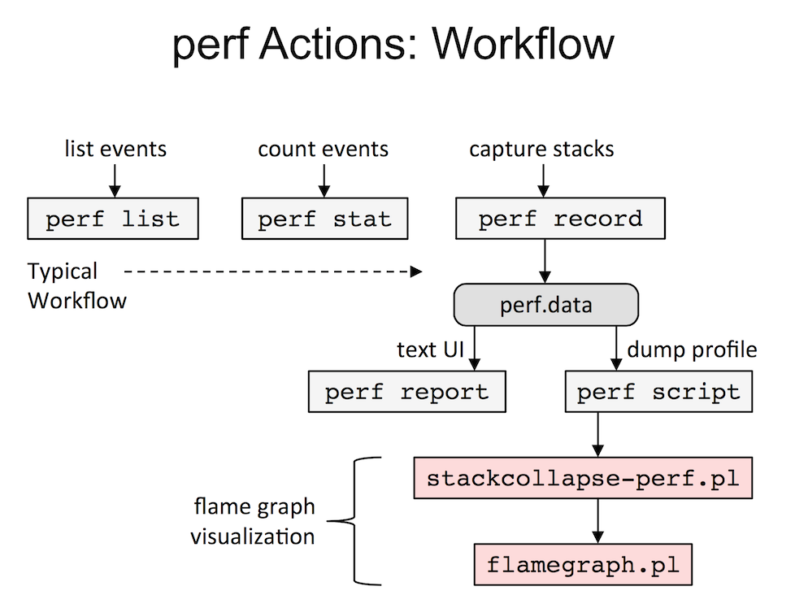
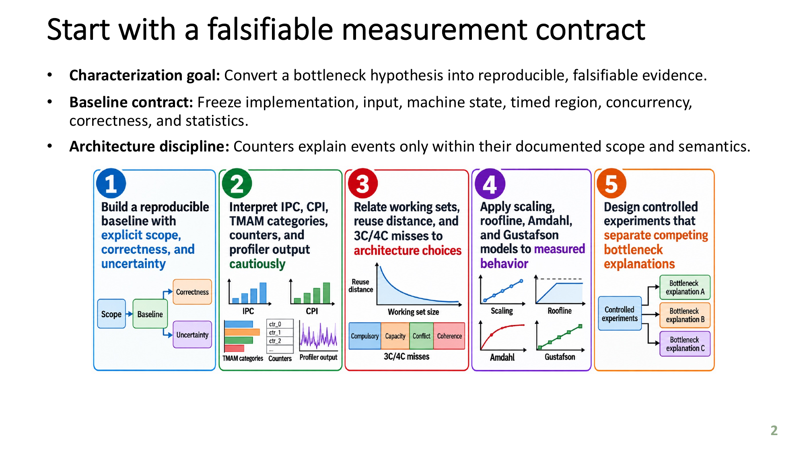

# Project 4. CSR SpMM: Profiling Access Locality Impact with Hotspot Analysis and Working Set Sweep

## 1. Introduction

This project studies how memory layout affects a single-threaded sparse
matrix–dense feature multiplication (SpMM) kernel on an Intel Xeon Gold 6526Y.
The kernel computes a weighted aggregation, $Y=AX$, where the sparse matrix
$A$ is stored in CSR format and the dense matrix $X$ contains feature vectors.
The same logical input is tested in two layouts: one preserves the natural
neighbor-to-feature access order, while the other permutes feature locations
to reduce spatial locality. Both layouts must produce the same numerical
result, so any performance difference can be attributed to memory access
behavior rather than a different computation.

Project 4 first validates the kernel, identifies its execution hotspot, and
then measures both layouts across increasing working-set sizes. Timing and
processor-counter measurements are collected only around the kernel so that
initialization and correctness checks do not obscure the comparison. The goal
is to learn how locality affects cache and TLB behavior, instruction
throughput, and normalized execution time, and to develop a disciplined way
to connect those measurements to performance without incorrectly claiming
that cache-miss counts alone measure DRAM traffic or bandwidth.

## 2. Reproduction Flow

``` bash
$ bash run.sh
```

## 3. System Information

``` bash
$ sudo python3 scripts/system_info.py
SYSTEM_INFO_LOGS=/home/kaiden/HwSwCoDesign/SpMM_A2/results/0_system_info
```

The script inspects `lscpu`, `/proc/sys/kernel/perf_event_paranoid`, relevant
`perf list` cache and TLB events, and the detailed
`perf list --details cache-misses` output. Each command is written to a
separate log under `results/0_system_info/`.

| Command | Purpose |
| --- | --- |
| `lscpu` | Selects the processor model, cache sizes, and NUMA topology fields used to characterize the host. |
| `cat /proc/sys/kernel/perf_event_paranoid` | Reports the operating-system policy governing access to performance counters. |
| `perf list` | Lists the cache and TLB events recognized by `perf` on the host. |
| `perf list --details cache-misses` | Shows how the named cache-miss event is resolved by `perf`. |

On Intel Emerald Rapids (Intel's 5th-generation Xeon Scalable server-processor
architecture), the benchmark uses the L2 event
`L2_RQSTS.DEMAND_DATA_RD_MISS`, encoded by the raw value `0x2124`. It counts
true demand data-read misses in the L2 cache and does not count misses that
were merged with other requests.

These counters describe different types of activity, and their coverage can
overlap or omit some misses. Do not add their values together as one total;
compare each counter separately. No single counter proves how much data reached
the memory controller or that the program is limited by DRAM bandwidth. Some
generic events may also be unavailable, depending on the Linux kernel and the
host system.

| Field | Value |
| --- | --- |
| Model name | Intel Xeon Gold 6526Y |
| BIOS model name | Intel Xeon Gold 6526Y |
| L1d cache | 1.5 MiB (32 instances) |
| L2 cache | 64 MiB (32 instances) |
| L3 cache | 75 MiB (2 instances) |
| NUMA nodes | 2 |
| NUMA node 0 CPUs | 0–15, 32–47 |
| NUMA node 1 CPUs | 16–31, 48–63 |

## 4. Workload

The workload in this project is **Compressed Sparse Row (CSR) Sparse-Dense Matrix Multiplication (SpMM)**, where Compressed Sparse Row (CSR) format is a common format used to store sparse matrices in a memory-efficient manner in many libraries.

In the function `csr_spmm()` in `SpMM_GNN_Aggregation_Benchmark.cpp`. This project benchmarks the weighted aggregation

$$
\mathbf{Y} = \mathbf{A}\mathbf{X}, \qquad
Y_{r,f} = \sum_{c\, :\, A_{r,c} \ne 0} A_{r,c}X_{c,f},
$$

where $\mathbf{A} \in \mathbb{R}^{R \times C}$ is a sparse matrix stored in Compressed Sparse Row (CSR) format, a common format in many libraries,
$\mathbf{X} \in \mathbb{R}^{C \times F}$ contains input feature vectors, and
$\mathbf{Y} \in \mathbb{R}^{R \times F}$ contains the aggregated output features.
The dense matrices $X$ and $Y$ use row-major storage. Each output feature vector is the weighted sum of its neighbors' input feature vectors.

| Symbol or array | Definition |
| --- | --- |
| $R$ | Number of rows in sparse matrix $A$ |
| $C$ | Number of columns in sparse matrix $A$ and rows in dense matrix $X$ |
| $NNZ$ | Number of nonzero entries in $A$ |
| $F$ | Number of features per row of $X$ and $Y$ |
| $A$ | Sparse $R \times C$ matrix in CSR format |
| $X$ | Dense $C \times F$ row-major feature matrix |
| $Y$ | Dense $R \times F$ row-major output matrix |
| `row_ptr` | `std::size_t` row offsets with $R+1$ entries |
| `col_idx` | `std::uint32_t` column indices with $NNZ$ entries |
| `values` | `double` nonzero weights with $NNZ$ entries |

<p align="center"></p>

The benchmark implements this aggregation kernel only; it does not include graph normalization, learned feature transformations, activation functions, or training.  Although the benchmark is only the aggregation kernel
rather than a complete GNN, it uses the usual graph terminology for this operation:

- **Source vertices:** The rows of $X$ represent input vertices. Their feature
  vectors are read by the kernel.
- **Destination vertices:** The rows of $Y$ represent output vertices. Their
  feature vectors are produced by aggregation.
- **Edges:** Each nonzero entry in $A$ represents a directed edge from input
  vertex $c$ to output vertex $r$. Therefore, $NNZ$ is the number of edges.
- **Edge weights:** The value $A_{r,c}$ is the weight associated with the edge
  from $c$ to $r$.
- **Features:** Each vertex has $F$ feature values, so each row of $X$ and $Y$
  is a feature vector.

For every edge, the kernel reads the source vertex's feature vector, multiplies
it by the edge weight, and adds it to the destination vertex's output vector.
The useful work is therefore proportional to $NNZ\times F$, which is why the
benchmark reports time per edge-feature operation.

## 5. Project Build

``` bash
$ python3 scripts/verify_benchmark.py
PMU_MODES=PASS
SELFTEST=PASS
LAYOUT_ORACLE=PASS checksum=386050.195312
VALIDATION=PASS (PMU hardware availability must be checked on target CPU)
```

The build script compiles `src/SpMM_GNN_Aggregation_Benchmark.cpp` to produce
the `build/spmm_gnn` executable, then runs the executable with its self-test.

## 6. Hotspot Analysis

Linux `perf` (Performance Events) is a performance-analysis tool that samples CPU activity
and reports where execution time is spent. The hotspot-analysis script uses it to
profile the benchmark and writes the record, report, annotation, and
provenance logs to `results/3_hotspot_analysis/`.

The profile covers the whole process, not solely the kernel. Report the sampled
event and scope. If profiling fails, preserve the error in the relevant log.

<p align="center">
    
    
</p>

The first figure shows the kinds of event sources that Linux `perf` can access,
including hardware PMCs. The second shows the command-line workflow used here:
`perf record` collects samples, while `perf report` and `perf annotate` inspect
the resulting profile.

``` bash
$ python3 scripts/hotspot_analysis.py
HOTSPOT_ANALYSIS_LOGS=/home/kaiden/HwSwCoDesign/SpMM_A2/results/3_hotspot_analysis
```

| Command | Purpose |
| --- | --- |
| `perf record` | Collects sampled execution data while the benchmark runs and saves it as a profile. |
| `perf report` | Summarizes the collected profile to show where execution time was spent. |
| `perf annotate` | Associates sampled execution data with source or assembly lines to identify hotspots in detail. |

In the generated profile, `main` accounts for 5.46% of self time, while its
child time is dominated by the SpMM kernel. The `csr_spmm` function accounts
for 93.56% of self time and 93.59% of child time, making it the primary
hotspot.

## 7. Timed Kernel and PMU

### 7.1 Benchmark Timing Markers

The benchmark uses explicit measurement boundaries to define which work is
included in each timing result. `t0` and `t1` surround CSR allocation and
construction, so their difference reports `setup_s`. A second pair of timing
points, `start` and `stop`, surrounds only the repeated `csr_spmm()` loop. That
interval produces `timed_kernel_s`, `ms_per_iter`, and the normalized
`ns_per_edge_feature` measurement. Correctness warm-up and final verification
are outside this timed kernel interval.

### 7.2 Kernel PMU Implementation

In our implementation, [`SpMM_GNN_Aggregation_Benchmark.cpp`](./src/SpMM_GNN_Aggregation_Benchmark.cpp)
uses `KernelPmu` to record hardware activity during the same interval as the
timed SpMM kernel. It starts the counters immediately before the SpMM loop and
stops them immediately afterward, excluding initialization and correctness
checks. Core mode measures cycles, instructions, generic cache misses, and IPC.
Levels mode measures L1D load misses, L2 demand data-read misses, LLC load
misses, and dTLB load misses.

The two modes are necessary because a CPU has a limited number of hardware PMU
counter slots. Trying to collect every requested event in one group can
overcommit those counters, causing Linux to multiplex events or reducing the
time for which they run. Splitting the events into core and levels groups avoids
that counter-resource overflow and makes each measurement set more reliable.
The modes therefore run in separate processes rather than being collected
simultaneously.

The implementation uses a **counter group**, which is a set of events opened
together so Linux can start, stop, and read them as one measurement. In
`prepare()`, the selected mode determines which events are requested. Each
`add()` call fills a `perf_event_attr` structure and passes it to the Linux
`perf_event_open` system call. The first successful event becomes the group
leader, and later events join that leader's group through its file descriptor.

At the timing boundary, `ioctl()` resets and enables the complete group before
the loop, then disables it afterward. `read()` retrieves all grouped values,
including the number of events, total time enabled, total time running, and the
individual counter values. These requests are handled by the Linux kernel,
which programs the Intel PMU; the benchmark does not send commands directly to
the CPU. Grouping also makes it possible to determine whether the events were
actually scheduled together and whether multiplexing reduced measurement
coverage.

Both modes report PMU availability and a running fraction for the measured
interval. Missing events are reported explicitly rather than treated as zero,
and a partial result can still be used when only some counters are unavailable.
The PMU values complement the elapsed-time measurements: they describe hardware
activity during the kernel, but they do not by themselves prove that a specific
amount of traffic reached DRAM.

## 8. Experiment

### 8.1 Self Test

The [self_test.py](./scripts/self_test.py) script runs the independent CSR
correctness check and writes its output to the
[self-test log folder](./results/2_self_test/).

``` bash
$ python3 scripts/self_test.py 
SELFTEST=PASS CSR_SPMM_ORACLE=PASS
SELF_TEST_LOG=/home/kaiden/HwSwCoDesign/SpMM_A2/results/2_self_test/Self_Test.log
```

The self test computes the following small matrix product:

$$
\mathbf{A} =
\begin{bmatrix}
2 & 0 & 0 & 1 \\
0 & -1 & 3 & 0 \\
4 & 0 & 0 & 0
\end{bmatrix},
\qquad
\mathbf{X} =
\begin{bmatrix}
1 & 2 \\
2 & 1 \\
3 & 0 \\
4 & -1
\end{bmatrix}.
$$

The CSR representation stores the nonzero values row by row:

```text
val = [2, 1 | -1, 3 | 4]
ci  = [0, 3 |  1, 2 | 0]
rp  = [0, 2, 4, 5]
```

The row pointers divide the nonzeros into three rows. Therefore:

$$
\begin{aligned}
Y_{0,:} &= 2X_{0,:} + 1X_{3,:} = [6, 3], \\
Y_{1,:} &= -1X_{1,:} + 3X_{2,:} = [7, -1], \\
Y_{2,:} &= 4X_{0,:} = [4, 8].
\end{aligned}
$$

Thus, the expected result is:

$$
\mathbf{Y} =
\begin{bmatrix}
6 & 3 \\
7 & -1 \\
4 & 8
\end{bmatrix}.
$$

The self test compares every output element with this explicit result, checking CSR traversal and accumulation independently of the generated benchmark workload.

### 8.2 Smoke Test

The smoke test validates the automated experiment pipeline. It uses a tiny
workload to check execution, correctness, both PMU modes, logging, CSV
generation, and result aggregation before the working-set sweep.

The [run_SpMM_results.py](./scripts/run_SpMM_results.py) script writes the
smoke-test output to the [smoke-test result folder](./results/4_smoke_test/)
and its logs to the [smoke-test log folder](./results/4_smoke_test/logs/).

``` bash
$ python3 scripts/run_SpMM_results.py --smoke --reps 1
R=8192 F=8 permuted rep=1 core=OK levels=OK
R=8192 F=8 local rep=1 core=OK levels=OK
RUN_COMPLETE=PASS folder=/home/kaiden/HwSwCoDesign/SpMM_A2/results/4_smoke_test
```

### 8.3 Working-Set Sweep

``` bash
$ python3 scripts/run_SpMM_results.py --reps 5
$ python3 scripts/plot_SpMM_results.py results/5_full_sweep/csv/summary.csv
```

For each case, the runner starts a separate benchmark process
with `--pmu` and another with `--pmu-levels`, checks that both results
are correct and have matching checksums, and then combines the measurements in
the output CSV files. The two PMU modes still run sequentially rather than
simultaneously, so the core's programmable-counter limit is not exceeded. The
[run_SpMM_results.py](./scripts/run_SpMM_results.py) script writes experiment
logs to the [full-sweep log folder](./results/5_full_sweep/logs/) and CSV
summaries to the [full-sweep CSV folder](./results/5_full_sweep/csv/). The
[plot_SpMM_results.py](./scripts/plot_SpMM_results.py) script reads the summary
and writes charts to the [full-sweep plots folder](./results/5_full_sweep/plots/).

The sweep changes the sparse-matrix row count and the number of features per
vertex. Because the benchmark uses $C=4R$ input vertices and stores each
feature as an 8-byte double, the dense input matrix $X$ has the following
working-set sizes:

| $R$ | $X$ at $F=8$ | $X$ at $F=32$ |
| ---: | ---: | ---: |
| 8,192 | 2 MiB | 8 MiB |
| 32,768 | 8 MiB | 32 MiB |
| 131,072 | 32 MiB | 128 MiB |
| 262,144 | 64 MiB | 256 MiB |

Here, $R$ is the number of sparse-matrix rows and $F$ is the feature width.
For example, at $R=8{,}192$ and $F=8$, $X$ contains
$4R\times F$ doubles, which occupies 2 MiB. Increasing either parameter
enlarges the data accessed by the kernel, allowing the experiment to observe
how locality changes as the feature table moves through and beyond the cache
hierarchy. These sizes describe $X$ only; the CSR arrays and output matrix
$Y$ add additional working-set data.

The L2 event is collected only after the script identifies an Emerald Rapids
CPU, and Linux must also permit access to it. Permissions, kernel support, or
PMU availability may prevent collection; if the L2 event is unavailable, its
result is reported as `N/A`, the experiment continues with any other available
counters, and `PMU_STATUS=PARTIAL` is acceptable when only some fields are
missing. Consult `PMU_UNAVAILABLE_EVENTS` for failure details and record the
CPU model. For meaningful comparisons, report per-iteration or per-nonzero
normalized counts within the same PMU mode, since different layouts can
reverse rankings at individual cache levels.

### 8.4 Targeted PMU Test

For one selected workload, the targeted PMU test runs the same two PMU passes
for both `local` and `permuted` layouts:

The [targeted_pmu_test.py](./scripts/targeted_pmu_test.py) script writes the
four command logs to the [targeted-PMU log folder](./results/6_targeted_pmu_test/).

``` bash
$ python3 scripts/targeted_pmu_test.py
TARGETED_PMU_LOGS=/home/kaiden/HwSwCoDesign/SpMM_A2/results/6_targeted_pmu_test
```

The four command outputs are saved under `results/6_targeted_pmu_test/` as
`local_pmu.log`, `local_pmu_levels.log`, `permuted_pmu.log`, and
`permuted_pmu_levels.log`.

- --pmu        = cycles, instructions, generic cache_misses, IPC.
- --pmu-levels = L1D load misses, L2 demand-data-read true misses,
               LLC load misses, data-TLB load misses.

Both modes ENABLE and DISABLE PMU counters around the timed kernel loop;
initialization, correctness warm-up, and final verification are excluded.
TWO separate invocations avoid exceeding the core's programmable counters.
Do not combine their cycle and miss counts as if simultaneous.

### 8.5 Detached Long-Running Sweep (Optional)

Use `nohup` for long-running sweep. This is not implemented in this project's framework.
The [run_SpMM_results.py](./scripts/run_SpMM_results.py) script writes the
detached sweep logs to the [full-sweep log folder](./results/5_full_sweep/logs/).

``` bash
$ nohup python3 scripts/run_SpMM_results.py --reps 5 --out results/5_full_sweep > sweep.log 2>&1 < /dev/null & echo $! > sweep.pid
$ tail -f sweep.log
$ ps -p "$(cat sweep.pid)" -o pid,stat,etime,cmd
```

## 9. Result

### 9.1 Hotspot Analysis

The hotspot profile confirms that the benchmark spends nearly all of its
sampled execution time in the intended kernel. `csr_spmm` accounts for 93.59%
of child time and 93.56% of self time, while `main` contributes 5.46% of self
time. The profile lost no samples, so the result provides a clear indication
that `csr_spmm` is the dominant hotspot rather than initialization or library
overhead.

### 9.2 Working-Set Results

<p align="center">
    
    
</p>

The working-set sweep completed all 16 layout/workload combinations with five
repetitions each. Every repetition passed the numerical correctness check, and
both core and cache/TLB PMU modes were usable for all five repetitions in
every case. The normalized time was consistently lower for the `local` layout
than for `permuted`: for example, at `R=131072, F=32`, local layout required
0.641 ns per edge-feature while the permuted layout required 1.475 ns, about
2.3 times more. At the largest `R=262144, F=32` case, the corresponding
values were 0.709 and 1.520 ns per edge-feature.

The PMU counters explain this layout sensitivity. In the targeted `R=131072,
F=32` test, the permuted layout produced about 130 million L1D load misses,
116 million L2 demand-read misses, and 127 million LLC load misses, compared
with about 62 million, 3 million, and 68 million for the local layout. Its IPC
also fell from 1.73 to 0.84, while both layouts produced the same checksum and
reported `PMU_STATUS=OK`. These counters are evidence of different cache
behavior, not a direct measurement of DRAM bandwidth.

### 9.3 Targeted PMU Test

The targeted test uses `R=131072`, `F=32`, eight nonzeros per row, and 30
iterations. Each PMU mode runs in a separate process, so the core-mode and
cache/TLB-mode timings should be compared between layouts, not treated as
simultaneous measurements.

| Layout | PMU mode | ns/edge-feature | IPC | Cache misses | L1D load misses | L2 demand-read misses | LLC load misses | dTLB load misses | Status |
| --- | --- | ---: | ---: | ---: | ---: | ---: | ---: | ---: | --- |
| local | core | 0.7077 | 1.732 | 134.7M | — | — | — | — | OK |
| local | levels | 0.6903 | — | — | 62.4M | 3.1M | 67.7M | 17.5K | OK |
| permuted | core | 1.4622 | 0.838 | 187.6M | — | — | — | — | OK |
| permuted | levels | 1.4961 | — | — | 130.4M | 116.5M | 126.8M | 25.0K | OK |

The targeted results reinforce the sweep observations. For this workload, the
permuted layout takes roughly twice as many nanoseconds per edge-feature as
the local layout, has about half the IPC, and produces more generic cache
misses. The level-specific counters show the largest difference in L2 demand
read misses, while L1D, LLC, and dTLB misses also increase. Both layouts still
pass correctness with the same checksum, and all counters report full
running fractions, so the performance difference is consistent with changed
access locality rather than different numerical work or unavailable PMU data.

## 10. Co-Design Seed

<p align="center">
    
    
    
    
</p>

**Hypothesis:** For the permuted layout, sort the `(col_idx, value)` pairs
within each CSR row by the physical source index in `col_idx`, while keeping
each edge weight attached to its index. This changes only the traversal
order—not the graph connectivity—and may improve source-feature locality. The
`local` layout remains the unchanged baseline. With eight nonzeros per row, the
preprocessing cost is approximately
`R × 8 × log₂(8) = 24R` comparisons: up to 6,291,456 comparisons at
`R=262,144`. The CSR storage size and the per-iteration kernel remain
unchanged, but the one-time preprocessing cost must be included in an
end-to-end comparison.

**Falsifiable experiment:** Apply this CSR-entry sorting only to the permuted
workload and repeat the same sweep, using the unchanged local layout as a
reference. Accept the hypothesis only if the reordered version reduces
normalized kernel time and relevant miss counters, and still improves total
performance after the preprocessing cost is amortized over the intended number
of iterations.

## 11. Conclusion

This project has two complementary performance-analysis parts. Hotspot
analysis identifies where execution time is concentrated, and the working-set
sweep with its plots shows whether a performance effect persists across
layouts and working-set sizes. Here, hotspot analysis identifies `csr_spmm` as
the dominant kernel, while the sweep shows that the local layout consistently
outperforms the permuted layout. Together, these steps connect a focused
kernel-level explanation with a broader comparison of the workload.

Going forward, this project provides a good example workflow: verify correctness,
use hotspot analysis to identify the repeated code, then use a sweep and
plots to test the effect across representative inputs. Results should be
normalized by the amount of useful work, such as edge-feature operations, so
different problem sizes can be compared fairly rather than being mistaken for
different implementations. PMU modes should remain isolated, and conclusions
should be based on consistent timing, normalized metrics, and processor-aware
counter interpretation.
