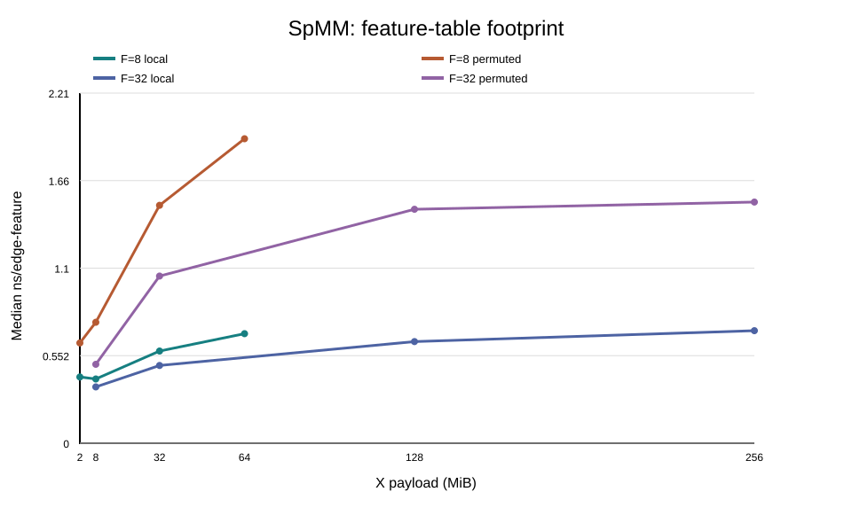
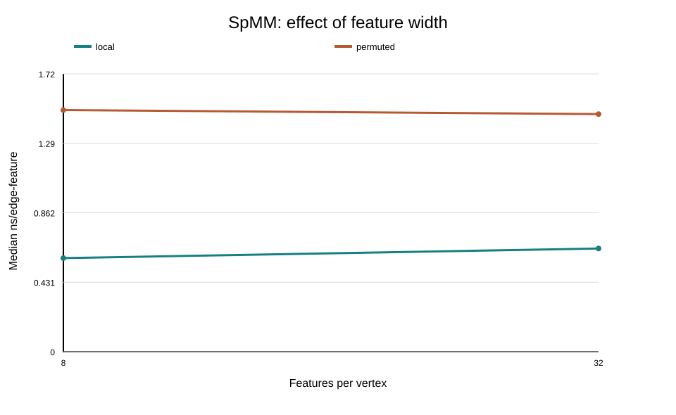

# Project 4: CSR SpMM Access-Locality Analysis

## 1. Workload

This project studies a single-threaded weighted sparse matrix–dense feature
multiplication (SpMM) kernel on an Intel Xeon Gold 6526Y. The kernel computes
`Y = AX`, with sparse matrix `A` stored in CSR format and dense source and
output feature matrices. Each nonzero edge reads an `F`-element source feature
vector and contributes a weighted vector to a destination row.

The same logical input is evaluated with two neighbor layouts. The `local`
layout preserves nearby source-feature accesses, while `permuted` deliberately
reduces that locality. Both layouts must produce the same checksum, so any
performance difference reflects memory-access behavior rather than different
numerical work. The sweep uses eight nonzeros per row, `C=4R`,
`R ∈ {8,192, 32,768, 131,072, 262,144}`, and `F ∈ {8, 32}`.

The benchmark implements only this aggregation kernel; it does not include
graph normalization, learned feature transformations, activation functions, or
training. Although it is not a complete GNN, it uses the usual graph
terminology for this operation:

- **Source vertices:** The rows of `X` represent input vertices whose feature
  vectors are read by the kernel.
- **Destination vertices:** The rows of `Y` represent output vertices whose
  feature vectors are produced by aggregation.
- **Edges:** Each nonzero entry in `A` represents a directed edge from input
  vertex `c` to output vertex `r`; therefore, `NNZ` is the number of edges.
- **Edge weights:** The value `A[r,c]` is the weight associated with the edge
  from `c` to `r`.
- **Features:** Each vertex has `F` feature values, so each row of `X` and `Y`
  is a feature vector.

For every edge, the kernel reads the source feature vector, multiplies it by
the edge weight, and adds it to the destination output vector. The useful work
is therefore proportional to `NNZ × F`, which is why the benchmark reports time
per edge-feature operation.

| Symbol or array | Definition |
| --- | --- |
| $R$ | Number of rows in sparse matrix $A$ |
| $C$ | Number of columns in sparse matrix $A$ and rows in dense matrix $X$ |
| $NNZ$ | Number of nonzero entries in $A$ |
| $F$ | Number of features per row of $X$ and $Y$ |
| $A$ | Sparse $R \times C$ matrix in CSR format |
| $X$ | Dense $C \times F$ row-major feature matrix |
| $Y$ | Dense $R \times F$ row-major output matrix |
| `row_ptr` | `std::size_t` row offsets with $R+1$ entries |
| `col_idx` | `std::uint32_t` column indices with $NNZ$ entries |
| `values` | `double` nonzero weights with $NNZ$ entries |

## 2. Reproduction Flow

``` bash
$ bash run.sh
```

## 3. System Information

``` bash
$ sudo python3 scripts/system_info.py
```

| Field | Value |
| --- | --- |
| Model name | Intel Xeon Gold 6526Y |
| BIOS model name | Intel Xeon Gold 6526Y |
| L1d cache | 1.5 MiB (32 instances) |
| L2 cache | 64 MiB (32 instances) |
| L3 cache | 75 MiB (2 instances) |
| NUMA nodes | 2 |
| NUMA node 0 CPUs | 0–15, 32–47 |
| NUMA node 1 CPUs | 16–31, 48–63 |

The table identifies the processor, cache capacities, and NUMA organization of
the host used for the experiment. The CPU ranges show which logical CPUs belong
to each NUMA node, providing the hardware context for interpreting cache and
memory-locality measurements.

## 4. Hotspot Analysis

``` bash
$ python3 scripts/hotspot_analysis.py
```

Linux `perf record` and `perf report` identified `csr_spmm` as the dominant
hot function. The profile lost no samples: `csr_spmm` accounted for 93.56% of
self time and 93.59% of child time, while `main` accounted for 5.46% of self
time. This confirms that the repeated SpMM kernel is the correct target for
the memory-hierarchy analysis.

## 5. Working-Set Analysis

``` bash
$ python3 scripts/run_SpMM_results.py --reps 5
$ python3 scripts/plot_SpMM_results.py results/5_full_sweep/csv/summary.csv
```

| $R$ | $X$ at $F=8$ | $X$ at $F=32$ |
| ---: | ---: | ---: |
| 8,192 | 2 MiB | 8 MiB |
| 32,768 | 8 MiB | 32 MiB |
| 131,072 | 32 MiB | 128 MiB |
| 262,144 | 64 MiB | 256 MiB |

The table shows how the dense feature-table footprint grows with the number
of rows and feature width. It is the intended working-set range for testing
whether the two layouts behave differently as the data grows through the cache
hierarchy.

The dense feature-table footprint is `X = 4R × F × 8` bytes. Kernel time is
reported as nanoseconds per edge-feature, which normalizes the measurements by
the useful work and permits comparisons across sizes and feature widths.

<p align="center">
  
  
</p>

All 16 layout/workload combinations completed five repetitions with matching
correctness results and usable PMU measurements. The local layout was faster in
every case. At `R=131,072, F=32`, local required `0.641` ns per edge-feature,
compared with `1.475` for permuted. At `R=262,144, F=32`, the corresponding
values were `0.709` and `1.520` ns per edge-feature.

## 6. Memory Hierarchy

The targeted test used `R=131,072`, `F=32`, eight nonzeros per row, and 30
kernel iterations. Core counters and cache/TLB counters were collected in
separate processes around the timed kernel.

| Layout | Mode | ns/edge-feature | IPC | Cache misses | L1D | L2 demand | LLC | dTLB |
| --- | --- | ---: | ---: | ---: | ---: | ---: | ---: | ---: |
| local | core | 0.7077 | 1.732 | 134.7M | — | — | — | — |
| local | levels | 0.6903 | — | — | 62.4M | 3.1M | 67.7M | 17.5K |
| permuted | core | 1.4622 | 0.838 | 187.6M | — | — | — | — |
| permuted | levels | 1.4961 | — | — | 130.4M | 116.5M | 126.8M | 25.0K |

Both layouts passed correctness and all targeted measurements reported
`PMU_STATUS=OK` with a running fraction of 1.0. The permuted layout took about
twice as long, had lower IPC, and produced substantially more L1D, L2, LLC, and
dTLB misses. The L2 value is the Emerald Rapids
`L2_RQSTS.DEMAND_DATA_RD_MISS` true demand-data-read event. These counters are
not a complete, non-overlapping accounting of all misses, and none directly
establishes DRAM traffic or bandwidth. Unsupported events are reported as
`N/A`, not zero.

## 7. Interpretation

Each nonzero edge reads an `F`-element source feature vector. With 8-byte
doubles, the useful source-feature data is approximately `NNZ × F × 8` bytes
per kernel iteration, before weights, indices, and output accesses. Increasing
`F` enlarges each neighbor access and reduces the number of feature vectors
that fit in a cache level. The local layout can reuse nearby cache lines,
whereas the permuted layout spreads accesses across the feature table. The
higher miss counts and lower IPC support this locality explanation.

A competing explanation is that page placement or NUMA/TLB behavior, rather
than cache locality alone, contributes to the slowdown. A discriminating test
would pin both layouts to the same CPU and NUMA node, use identical first-touch
placement, and repeat the sweep. If the performance gap remains while
placement is controlled, the locality explanation becomes stronger.

## 8. Co-Design Seed

**Hypothesis:** For the permuted layout, sort the `(col_idx, value)` pairs
within each CSR row by the physical source index in `col_idx`, while keeping
each edge weight attached to its index. This changes only the traversal
order—not the graph connectivity—and may improve source-feature locality. The
`local` layout remains the unchanged baseline. With eight nonzeros per row, the
preprocessing cost is approximately `R × 8 × log₂(8) = 24R` comparisons, or up
to 6,291,456 comparisons at `R=262,144`.

**Falsifiable experiment:** Apply this CSR-entry sorting only to the permuted
workload and repeat the same sweep, using the unchanged local layout as a
reference. Accept the hypothesis only if the reordered version reduces
normalized kernel time and relevant miss counters, and still improves total
performance after the preprocessing cost is amortized over the intended number
of iterations.

