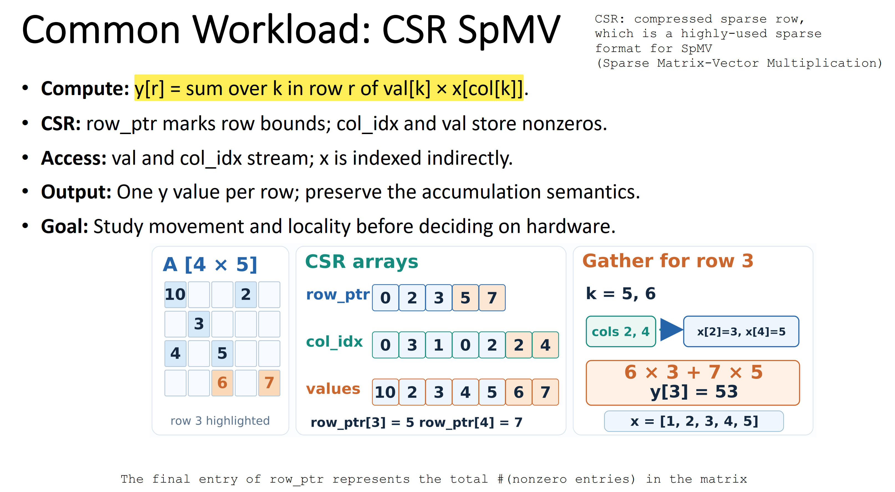
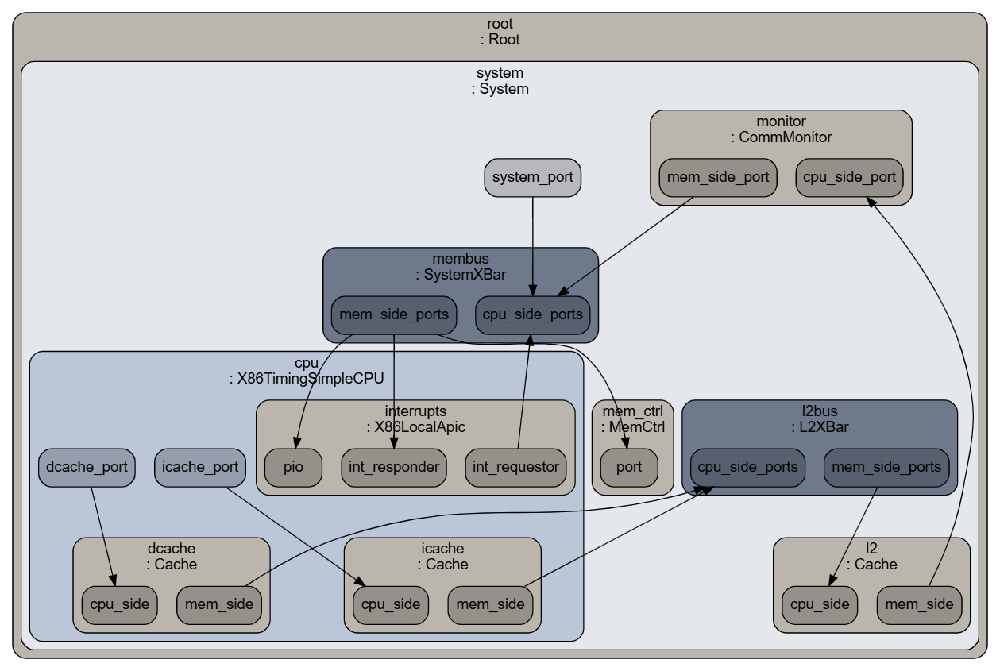

# Project 5: CSR SpMV: DDR4 vs HBM2 Off-chip Memory Access Comparison using Gem5 and Ramulator

## 1. Introduction

This project investigates how memory access locality and DRAM organization affect
CSR sparse matrix–vector multiplication (SpMV). It combines gem5 CPU and cache
simulation with standalone Ramulator DDR4 and HBM2 trace replay to compare
scattered and clustered access patterns.

The workflow measures the SpMV kernel in gem5, captures memory requests after L2,
and evaluates the recorded traffic under both memory models. Separate
request-equivalent and byte-equivalent experiments distinguish the effects of
transaction count and logical data volume. Automated correctness checks, trace
validation, and completion accounting support reproducible reports of execution
time, memory traffic, and controller behavior.

The comparison reports gem5 kernel execution and standalone memory replay as
separate measurements. Replay ratios characterize the selected memory models
under recorded traffic; they do not represent end-to-end application speedups.

## 2. Quick Start

```bash
$ bash run.sh
```

[scripts/run_experiments.py](scripts/run_experiments.py) coordinates execution.
Stage functions from `check` through `payload` live in
[scripts/experiment_stages.py](scripts/experiment_stages.py). Its `payload_stage()`
wraps [replay_byte_equivalent.py](scripts/replay_byte_equivalent.py); the report
stage lives in [generate_report.py](scripts/generate_report.py).

| Stage | Work | Requires valid outputs from |
|---|---|---|
| `check` | Tool/import access, reference-source presence/hash recording and installed drain patch | None |
| `baseline` | Compile/run the original baseline; require oracle PASS | None |
| `generate` | Snapshot harness, gem5 config and verified oracle | None |
| `build` | Compile the gem5 guest binary with real ROI markers | `generate` |
| `gem5` | Sequential locality cases, ROI markers and guest oracle | `build` |
| `trace` | Decode protobuf, select ROI request timestamps, audit commands/counts | `gem5` |
| `replay` | Original one-record-per-request DDR4/HBM2 replay and drain audit | `trace` |
| `payload` | One 64B DDR4 request versus two adjacent 32B HBM2 requests | `trace` |
| `report` | Generate separate gem5 and byte-equivalent replay evidence tables | `payload` |

See [Files and Usage](docs/files_and_usage.md) for requirements, configuration,
partial runs, continuation, direct replay, and numbered stage log files. For a guided
code walkthrough, follow [skim_order.md](docs/skim_order.md).

## 3. Workload



The workload is the same compressed sparse row (CSR) sparse matrix-vector
multiplication (SpMV) used in Project 1 and Project 2.

[week7_spmv_lab.cpp](src/week7_spmv_lab.cpp) provides the reference computation
and CSR validation helpers. The experiment harness,
[csr_spmv_large_roi.cpp](templates/csr_spmv_large_roi.cpp), includes that code but
replaces the original program's entry point with its own `main()`. Instead of
running the small reference example, this `main()` reads workload options,
generates the matrix and input vector, runs the measured kernel, and checks its
output against the original `csr_spmv()` function.

The default input has 32,768 rows, 16 nonzeros per row, and 262,144 columns:
524,288 nonzeros in total. These dimensions create enough memory traffic to
study locality beyond the small reference example. The `--rows`,
`--nnz-per-row`, and `--cols` options control the input size.

Calls to `m5_work_begin()` and `m5_work_end()` mark the start and end of the SpMV
accumulation loop. Gem5 uses these markers to measure that region of interest
(ROI), leaving allocation, input generation, and reference verification outside
the timing interval.

To study locality, the input generator creates two column-index patterns:

| Pattern | Accesses to the input vector `x` |
|---|---|
| Scattered | Column indices span the full vector, spreading accesses across `cols` entries. |
| Clustered | Column indices stay within the first 2048 entries, concentrating accesses in a smaller region. |

Both cases use the same dimensions, number of nonzeros, and value-generation
rule. Index generation is deterministic so the inputs are reproducible.
Each case is checked against its own reference result; changing column indices
changes the matrix, so the two output vectors need not match.

## 4. Experiments

Gem5 runs the compiled workload and records requests leaving L2. Ramulator then
reads the filtered request trace to simulate DDR4 and HBM2; it does not execute
the C++ program.

```text
CSR SpMV executable → gem5 CPU/cache/DDR4 simulation → post-L2 ROI trace
                                                          ├→ Ramulator DDR4
                                                          └→ Ramulator HBM2
```

### 4.1 Gem5: System under Simulation and Memory Access Trace Monitor



The system is defined in [gem5_kernel_roi.py](templates/gem5_kernel_roi.py):

| Component | Configuration |
|---|---|
| Execution mode | x86 syscall emulation; no guest operating system is booted |
| CPU | One `X86TimingSimpleCPU` at 2 GHz |
| L1 instruction cache | 32 KiB, 4-way associative |
| L1 data cache | 32 KiB, 8-way associative |
| L2 cache | 256 KiB, 8-way associative |
| Memory | Gem5 `MemCtrl` with `DDR4_2400_8x8` |
| Memory address range | 512 MiB |

The workload brackets the accumulation loop with `m5_work_begin()` and
`m5_work_end()`. Gem5 resets statistics at the first marker and dumps them at the
second, excluding allocation, input generation, and reference verification from
the measured interval. Resetting counters leaves cache contents intact. The
reported kernel time therefore includes the CPU and cache behavior during this
interval.

A `CommMonitor` between L2 and the memory bus records requests in a binary
protobuf trace. The trace stage in
[experiment_stages.py](scripts/experiment_stages.py) selects requests whose
timestamps fall within the ROI and exports their operations and addresses as
`LD`/`ST` records. These are requests crossing L2, including possible instruction
traffic, rather than every load or store in the source code.

### 4.2 Ramulator: Off-chip Memory Access Trace Replay

Each case's exported trace is replayed through two standalone Ramulator models.
Although gem5 uses DDR4 while collecting the trace, the monitor records requests
before they reach that controller. The exported operations and addresses can
therefore be supplied to either memory model, which generates its own memory
commands and timing.

| Setting | DDR4 | HBM2 |
|---|---|---|
| Organization preset | `DDR4_8Gb_x8`, one rank | `HBM2_2Gb` |
| Timing preset | `DDR4_2400R` | `HBM2_2000Mbps` |
| Controller | `GenericDDR` | `HBM12` |

Both models use one controller with FR-FCFS scheduling, an open-row policy,
all-bank refresh, and `RoBaRaCoCh` address mapping. The trace frontend attempts
one request per frontend cycle, subject to backpressure, with a 1:1
frontend-to-memory clock ratio. Original gem5 request timestamps are not replayed.
This compares the configured memory models under normalized injection.

Two replay methods distinguish equal request counts from equal data volumes:

| Method | DDR4 Input | HBM2 Input | Held Equal |
|---|---|---|---|
| Request-equivalent | One request per trace record | One request per trace record | Request count |
| Byte-equivalent | One 64-byte request per original record | Two adjacent 32-byte requests per original record | Logical bytes |

[replay_request_equivalent.py](scripts/replay_request_equivalent.py) implements
the first method. In the second,
[replay_byte_equivalent.py](scripts/replay_byte_equivalent.py) splits each
original request at address `a` into HBM2 requests at `a` and `a + 32`. The final
report uses this byte-equivalent comparison, while request-equivalent replay is
retained as separate evidence.

Before accepting a replay, the framework checks that submitted and completed
requests reconcile, including forwarded reads and coalesced writes, and that no
requests remain outstanding. Controller cycles, modeled time, and row-buffer
statistics are collected for comparison in the results section.

The trace was collected during execution with gem5's DDR4 controller. Replaying
it through HBM2 does not feed HBM2 latency back to the CPU or reproduce how that
CPU would generate requests with HBM2 attached. The replay comparison measures
memory-model behavior for recorded traffic, not complete application execution
on two different memory systems.

## 5. Experiment Results

The results below use the default workload: 32,768 rows, 16 nonzeros per row,
and 262,144 columns, for a total of 524,288 nonzeros in each case.
Detailed observations and evidence can be found under
[docs/experiment_result.md](docs/experiment_result.md).

### 5.1 Gem5: Memory Access Locality Comparison

| Pattern | gem5 ROI Time (ms) | Exported Reads | Exported Writes | Total Exported Requests | Logical Bytes (B) |
|---|---:|---:|---:|---:|---:|
| Scattered | 47.385717 | 480,956 | 2,062 | 483,018 | 30,913,152 |
| Clustered | 13.706270 | 69,776 | 1,954 | 71,730 | 4,590,720 |
| Scattered / Clustered | 3.457× | 6.893× | 1.055× | 6.734× | 6.734× |

The scattered case takes 3.46× as long as the clustered case and exports
6.73× as many requests. Most of the traffic difference comes from reads:
480,956 for scattered accesses versus 69,776 for clustered accesses.
The smaller working set in the clustered case gives the caches more opportunity
to serve accesses before they reach memory. Logical bytes count the exported
64-byte read/write requests; skipped `CleanEvict` records are excluded.

### 5.2 Ramulator: Request-equivalent Trace Replay

| Pattern | Model | Requests | Logical Bytes (B) | Controller Cycles | Modeled Time (ms) | Row-buffer Hit Rate | Average Read Latency (ns) |
| --- | --- | ---: | ---: | ---: | ---: | ---: | ---: |
| Scattered | DDR4 | 483,018 | 30,913,152 | 2,507,545 | 2.089 | 25.36% | 166.235 |
| Scattered | HBM2 | 483,018 | 15,456,576 | 1,344,218 | 1.344 | 14.70% | 118.317 |
| Clustered | DDR4 | 71,730 | 4,590,720 | 382,715 | 0.319 | 96.77% | 163.211 |
| Clustered | HBM2 | 71,730 | 2,295,360 | 107,130 | 0.107 | 92.37% | 65.868 |

HBM2 completes the request-equivalent replay in less modeled time for both
patterns. However, each model receives the same request count while DDR4
represents 64 bytes per request and HBM2 represents 32 bytes. HBM2 therefore
handles only half the logical bytes in this comparison. The timing difference
alone cannot establish how the models compare when serving the same data volume.

Both models have higher row-buffer hit rates for clustered traffic. HBM2 has
lower average read latency than DDR4 for both patterns, but its scattered hit
rate is lower than DDR4's. Row-buffer hit rate alone therefore does not explain
the latency difference. These are per-transaction averages with different
payload sizes: 64 bytes for DDR4 and 32 bytes for HBM2.

### 5.3 Ramulator: Byte-equivalent Trace Replay

| Pattern | Model | Logical Bytes (B) | Requests | Controller Cycles | Modeled Time (ms) | Row-buffer Hit Rate | Average Read Latency (ns) |
| --- | --- | ---: | ---: | ---: | ---: | ---: | ---: |
| Scattered | DDR4 | 30,913,152 | 483,018 | 2,507,545 | 2.089 | 25.36% | 166.235 |
| Scattered | HBM2 | 30,913,152 | 966,036 | 1,691,297 | 1.691 | 55.32% | 78.933 |
| Clustered | DDR4 | 4,590,720 | 71,730 | 382,715 | 0.319 | 96.77% | 163.211 |
| Clustered | HBM2 | 4,590,720 | 143,460 | 234,582 | 0.235 | 95.83% | 70.179 |

With equal logical byte counts, HBM2 still finishes in less modeled time in
both cases. DDR4 takes 1.235× the HBM2 replay time for scattered traffic and
1.359× for clustered traffic. HBM2 processes twice as many requests to represent
the same bytes, so these ratios compare equal payloads rather than equal
transaction counts. 

Both models have much higher row-buffer hit rates for clustered traffic.
HBM2 has a higher hit rate for scattered traffic, while DDR4's clustered hit
rate is slightly higher than HBM2's. HBM2 nevertheless has lower average read
latency than DDR4 for both patterns; hit rate alone does not explain replay time. Scheduling, model timing, and transaction
splitting also affect the comparison.

### 5.4 Observations

| Assumption | Implication |
|---|---|
| Traffic is recorded after L2 during the gem5 ROI. | Counts reflect requests crossing that boundary, potentially including instruction traffic, rather than every source-level access. |
| Replay uses normalized injection and discards original gem5 timestamps. | Request spacing and queue pressure differ from the original CPU execution. |
| Both models consume traffic derived from gem5's DDR4 execution. | HBM2 latency does not feed back into CPU execution or change the captured request stream. |
| Each replay uses the configured single-controller memory model. | Results do not describe a complete HBM stack or an entire physical memory subsystem. |
| gem5 ROI time and standalone replay time come from separate simulations. | Replay ratios are not end-to-end SpMV speedups; the two times cannot be added to predict application runtime. |

These assumptions limit the findings to the recorded traffic and configured
models; predicting application performance with HBM2 would require its memory
responses to feed back into CPU execution.

| Comparison | Observation |
|---|---|
| Memory access locality | Clustered inputs reduce gem5 kernel time and exported post-L2 traffic in this setup. |
| Request-equivalent trace replay | HBM2 has lower replay time, but serves half the logical bytes because each model receives the same number of differently sized transactions. |
| Byte-equivalent trace replay | HBM2 has lower replay time for both patterns while serving the same logical byte volume as DDR4, using twice as many transactions. |

The byte-equivalent replay provides the main DDR4/HBM2 comparison because both
models serve the same logical data volume. The request-equivalent results show
how unequal payloads can widen the apparent timing gap.

## 6. Conclusion

The experiments show that locality matters at both the CPU/cache and memory
controller levels. Clustered CSR SpMV accesses reduce gem5 kernel execution time
from 47.386 ms to 13.706 ms and exported post-L2 traffic by a factor of 6.73.
For equal logical byte volumes, the configured HBM2 model also completes the
standalone replay sooner than DDR4, whose replay time is 1.235× higher for
scattered traffic and 1.359× higher for clustered traffic. These findings support
improving access locality and comparing memory models on equal payloads, while
keeping application execution and controller replay measurements separate.

The main lesson from combining gem5 and Ramulator is that the assumptions define
what a comparison can establish. Future experiments should state the trace
boundary and ROI, transaction sizes, address mapping, clock periods, injection
policy, and modeled channel/controller scope before interpreting timing ratios.
Equal-byte comparisons should be accompanied by request counts and completion
checks, and latency should be converted to common time units. In particular,
this workflow discards request timestamps and replays DDR4-derived traffic
without CPU feedback, so it measures memory-model behavior under those conditions.
Claims about end-to-end HBM2 application performance should instead use a setup
where memory responses influence CPU execution, with its timing and system
assumptions documented and validated.
