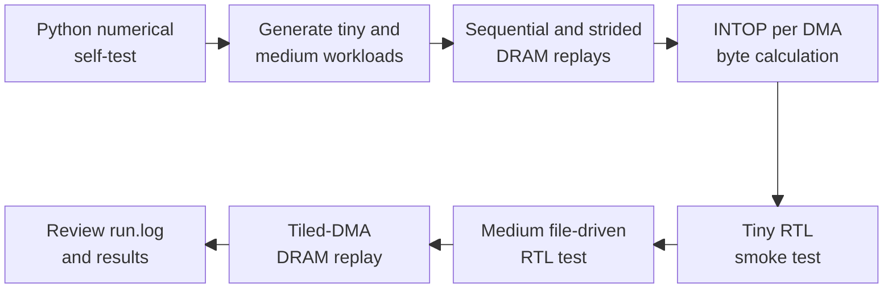
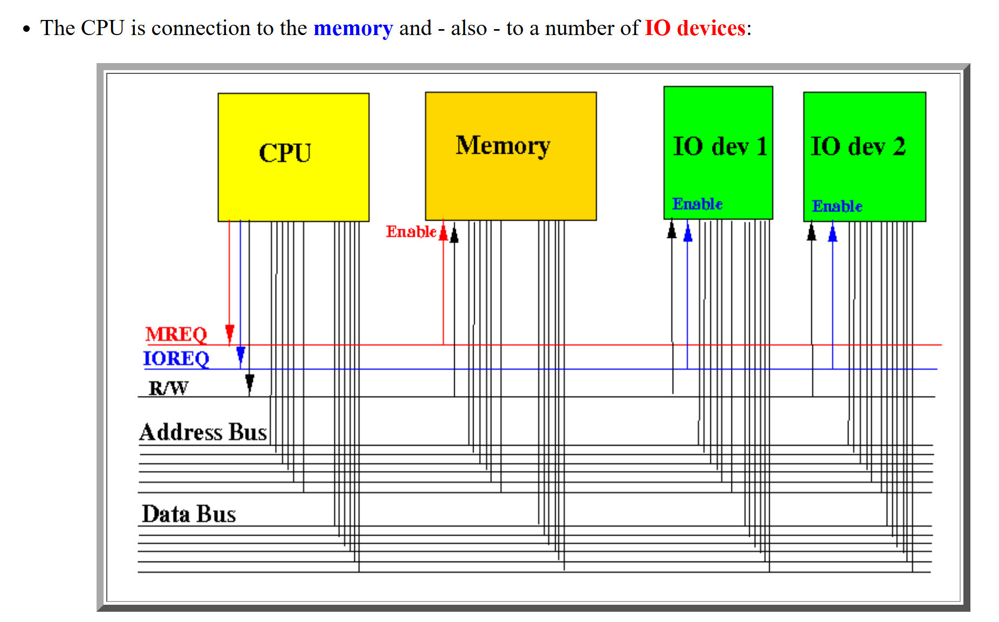
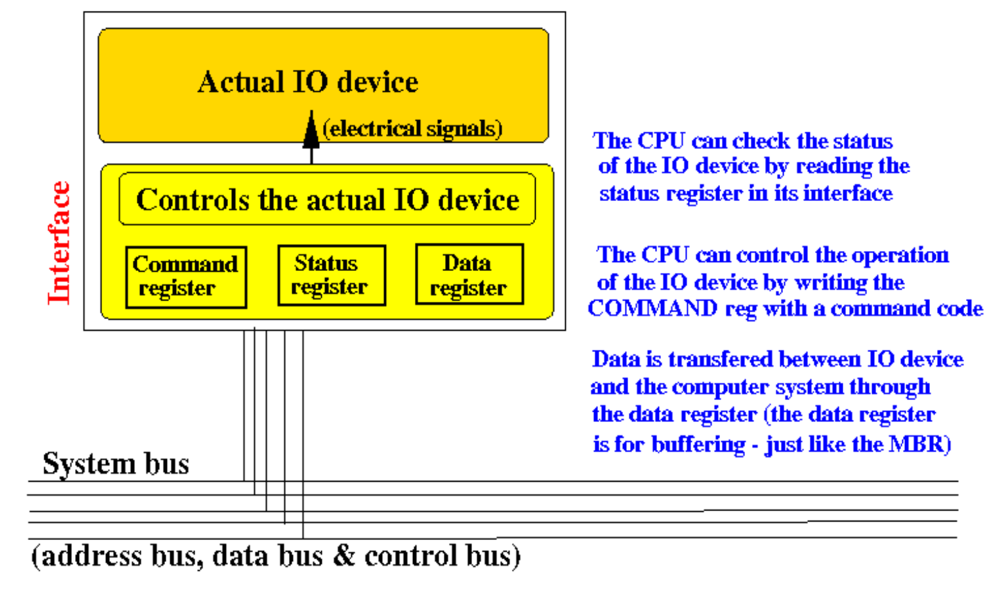
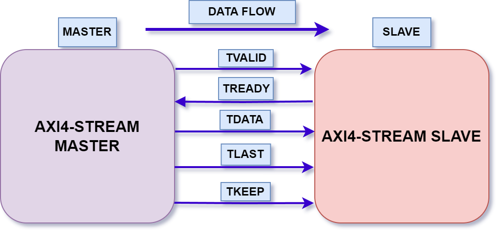
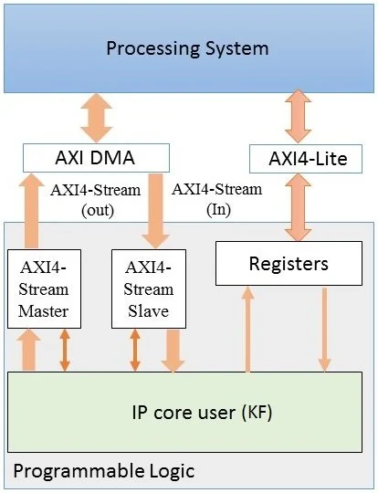

# Week 9.1 CSR SpMV: AXI4-Stream Accelerator DDR3 Trace Replay and Row-Buffer Analysis with Ramulator

## 1. Introduction

This project studies how a streaming accelerator can execute CSR sparse
matrix–vector multiplication, `y = A × x`, while reusing portions of `x` in
on-chip memory. Software groups nonzeros by `x` tile and prepares commands for
an RTL engine with AXI4-Stream interfaces. The engine loads each tile, performs
signed multiplication and row accumulation, and streams the completed `y`.
Verilator validates the datapath against independently generated reference
results using tiny and medium workloads, including output backpressure.

The memory study uses Ramulator to replay synthetic DDR3 requests for controlled
sequential/strided accesses and modeled command/result buffer movement. It
examines row-buffer behavior, request completion, and controller timing, then
calculates integer arithmetic intensity at the command/result boundary. These
experiments separate RTL correctness from DRAM behavior: the replay is not
coupled to the RTL, and the project does not implement a physical DMA path or
measure end-to-end FPGA acceleration.

## 2. Reproduction Flow

```bash
$ bash run.sh
```

Environment settings are loaded from `config/default.env`. The project root is
detected from `run.sh`; outputs remain under its `results/` directory. Set `PY`
to override the default course Python interpreter. The configuration file uses
Bash syntax and is included in the source hashes recorded in `run.log`.



See [docs/files_and_usage.md](docs/files_and_usage.md) for source responsibilities,
individual commands, and output filenames. The runner also records source hashes
and tool versions in the transcript.

## 3. Workload

The workload is signed-integer sparse matrix–vector multiplication (SpMV).
Software groups nonzeros by `x`-vector tile and emits 64-bit commands. The RTL
loads `x` values into local RAM, multiplies matrix values by stored `x` entries,
accumulates row results, and drains every output row.

| Property | Tiny | Medium |
| --- | --- | --- |
| Matrix rows × columns | 4 × 5 | 1,024 × 4,096 |
| Nonzeros | 6 | 8,192; 8 per row |
| Input pattern | Fixed four-row oracle | Deterministic scattered |
| `x`-tile capacity | 8 entries | 2,048 entries |
| Nonempty `x` tiles | 1 | 2 |
| `x`-load commands | 5 | 4,096 |
| Total input commands | 13 | 12,290 |
| Expected output | `[6, 6, -1, 15]` | All rows checked against the generated oracle |

Matrix values and `x` entries must fit signed 16-bit integers; partial sums and
results must fit signed 32-bit integers. Each contribution counts as one integer
multiply plus one integer add.

The tiny RTL smoke test uses commands and expected `y` hardcoded in
`tb/tb_week9_spmv_axis.sv`. The medium test uses `tb/tb_week9_file.sv` to load
`inputs/cmds.memh` and `inputs/expected.memh` from its workload directory and
compare every output row. Both tests inject output backpressure and check that
data and `TLAST` remain stable until accepted. Successful runs emit
`W9_VERILATOR_SPMV=PASS` and `W9_FILE_RTL=PASS`, respectively, in `run.log`.

## 4. RTL Accelerator Design with AXI4-Stream Interface

### 4.1. Interface

<p align="center">
    
    
</p>

**AXI** (Advanced eXtensible Interface) is an Arm AMBA interface family for communication between hardware blocks. The interfaces serve different purposes:

| Interface | Transfer model | Typical use |
| --- | --- | --- |
| **AXI4** | Memory-mapped reads and writes with addresses and burst transfers | Moving bulk data to or from memory |
| **AXI4-Lite** | Simplified memory-mapped reads and writes with single-beat transfers | Accessing configuration, control, and status registers |
| **AXI4-Stream** | Ordered data beats with ready/valid handshakes and no memory addresses | Passing commands or results between a DMA engine and an accelerator |

See the [AMD AXI reference guide](https://www.amd.com/content/dam/xilinx/support/documents/ip_documentation/axi_ref_guide/latest/ug1037-vivado-axi-reference-guide.pdf) for the interface distinctions.

AXI DMA bridges memory-mapped accesses and AXI4-Stream transfers: MM2S reads a memory buffer and produces a stream, while S2MM accepts a stream and writes a memory buffer. Software accesses the DMA control and status registers through AXI4-Lite. See the [AXI DMA overview](https://docs.amd.com/r/en-US/pg021_axi_dma/Core-Overview).

The accelerator in [rtl/week9_spmv_axis.sv](rtl/week9_spmv_axis.sv) chooses **AXI4-Stream as its interface to AXI DMA**. A 64-bit slave input accepts commands; a 32-bit master output returns `y`. The intended board integration uses MM2S for commands and S2MM for results. The current simulation drives these streams directly from the testbench; DMA is not instantiated.

Transfers occur on ready/valid handshakes; output data and `TLAST` remain stable under backpressure, with `TLAST` asserted for the final row. The accelerator exposes debug counters but does not implement a software-accessible AXI4-Lite register bank.

<p align="center">
    
    
</p>

### 4.2. RTL Design

The design consists of:

- **Hardware:** A single signed 16×16 multiplier and 32-bit accumulator process contributions from `A` using locally stored `x`. Commands clear `y`, load an `x` tile, perform MAC operations, and drain every output row.
- **Registers:** `state` controls execution; `row_q`, `a_q`, `x_q`, and `y_q` retain a MAC's destination and operands. `row_idx` selects rows during clearing and draining, while `out_q` holds the output beat. Debug counters expose accepted MACs, accepted loads, and elapsed cycles.

| Memory | RTL organization | Purpose | Medium workload storage |
| --- | --- | --- | --- |
| `xmem` | `TILE` signed 16-bit entries | Holds the current `x` tile, loaded through LOAD_X commands | 2,048 entries: 4 KiB |
| `ymem` | `N_ROWS` signed 32-bit entries | Holds accumulated `y` for every row, including empty rows | 1,024 entries: 4 KiB |

Both arrays carry `ram_style = "block"` attributes to request BRAM inference. Actual BRAM mapping and resource usage require synthesis; Verilator simulates their RTL behavior. Reset initializes the control registers, CLEAR_Y initializes `ymem` one row per cycle, and LOAD_X initializes the needed `xmem` entries.

When a MAC command is accepted in READY, synchronous reads capture `xmem` and `ymem` into `x_q` and `y_q`. MAC_WRITE commits the signed product plus the previous sum on the next clock. Input acceptance stalls during writeback to avoid row-update hazards. Draining alternates OUT_READ and OUT_VALID, advancing the row only after the receiver accepts the output.

## 5. Experiments

Before the experiments, the Python self-test verifies the four-row oracle and
eight pattern/tile combinations, emitting `W9_PYTHON_SELFTEST=PASS` in `run.log`.

### 5.1. DRAM Row-Buffer Locality

This experiment compares sequential reads with a 16-byte address stride against
reads with an 8,192-byte stride. Each synthetic trace issues 4,096 distinct
16-byte reads (65,536 logical bytes); the request counts match, but the address
footprints differ. These are controlled DRAM microbenchmarks, not traces of
actual accelerator execution.

Ramulator uses `DDR3_4Gb_x16` with `DDR3_1066F` timing, one channel, FRFCFS
scheduling, Open row policy, and RoBaRaCoCh address mapping. Compare the reported
row hits, misses, conflicts, controller cycles, and average read latency. Row
behavior depends on the mapper and controller configuration; stride alone does
not establish whether accesses conflict.

The reports are written under `results/medium/reports/dram_stats/`:

| Trace | Metrics file |
| --- | --- |
| Sequential | `w9_dram_sequential_16B.ramulator_metrics.json` |
| Strided | `w9_dram_strided_16B.ramulator_metrics.json` |

Inspect the corresponding raw `.ramulator_stats.yaml` files and drain markers
in `run.log` to confirm that submitted and completed request counts match and
no requests remain outstanding.

### 5.2. Accelerator Memory-Traffic Replay

Python generates `traces/tiled_dma_16B.ldst` from the command and result buffer
sizes. The trace contains contiguous reads covering the 64-bit input commands,
followed by contiguous writes covering the 32-bit `y` results. Each logical
request represents 16 bytes, with buffer sizes rounded up to whole requests.

Ramulator replays these requests using the same DDR3 controller configuration
and writes `tiled_dma_16B.ramulator_metrics.json` plus raw statistics under
`results/medium/reports/dram_stats/`. Check read/write counts, request completion,
row-buffer classifications, and controller cycles.

This is a synthetic memory-traffic replay, not a DMA-engine simulation. The trace
is generated independently of Verilator and contains no request timestamps or
CPU/RTL feedback. AXI handshakes, DMA setup, stream backpressure, and physical
board delays are outside the replay boundary; controller cycles are not measured
DMA transfer time.

### 5.3. Arithmetic Intensity

This calculation reads the workload manifest and counts integer operations
against the minimum command/result bytes at the intended DMA boundary:

| Quantity | Calculation |
| --- | --- |
| Integer operations | `2 × NNZ`: one multiply and one add per contribution |
| Input command bytes | `8 × command_count` |
| Output result bytes | `4 × N_ROWS` |
| Arithmetic intensity | `(2 × NNZ) / (8 × command_count + 4 × N_ROWS)` INTOP/byte |

The report is `results/medium/reports/w9_roofline_intensity_proxy.json`.
This byte count excludes host preprocessing, source CSR reads, cache maintenance,
DDR arbitration, AXI protocol overhead, and padding in the separate DRAM trace.
It is an integer arithmetic-intensity proxy, not a measured platform roofline;
no sustained bandwidth or achieved accelerator throughput is measured here.

The annotated cycle table or waveform, selected RTL reasoning exercise,
PS–DDR3–DMA–PL integration diagram, and feasibility discussion remain manual lab
report tasks. CPU profiling and preprocessing-cost experiments are outside this project.

## 6. Results

Both tiny and medium RTL validation tests passed, as recorded in [run.log](run.log).

### 6.1. DRAM Row-Buffer Locality

The [results/medium/reports/dram_stats/w9_dram_sequential_16B.ramulator_metrics.json](results/medium/reports/dram_stats/w9_dram_sequential_16B.ramulator_metrics.json)
and [results/medium/reports/dram_stats/w9_dram_strided_16B.ramulator_metrics.json](results/medium/reports/dram_stats/w9_dram_strided_16B.ramulator_metrics.json)
show different row-buffer behavior under the configured DDR3 model. Completion
and outstanding counts are confirmed by the drain markers in [run.log](run.log).

| Trace | Completed / submitted | Outstanding | Row hits | Misses | Conflicts | Row-hit fraction | Controller cycles |
| --- | --- | --- | --- | --- | --- | --- | --- |
| Sequential | 4,096 / 4,096 | 0 | 4,059 | 32 | 5 | 99.10% | 17,011 |
| Strided | 4,096 / 4,096 | 0 | 0 | 20 | 4,076 | 0.00% | 57,209 |

The sequential trace achieves a 99.10% row-hit fraction, while the
strided trace has no row hits and 4,076 conflicts. Dividing the recorded cycle
counts gives approximately 3.36 times as many controller cycles for the strided
trace. This derived comparison describes these synthetic address sequences and
this mapper/controller configuration; the traces have different footprints.

### 6.2. Accelerator Memory-Traffic Replay

The [results/medium/reports/dram_stats/tiled_dma_16B.ramulator_metrics.json](results/medium/reports/dram_stats/tiled_dma_16B.ramulator_metrics.json)
record the following results; request completion is confirmed in [run.log](run.log).

| Quantity | Recorded value |
| --- | --- |
| Reads | 6,145 |
| Writes | 256 |
| Completed / submitted requests | 6,401 / 6,401 |
| Outstanding requests | 0 |
| Row hits / misses / conflicts | 6,343 / 50 / 8 |
| Row-hit fraction | 99.09% |
| Controller cycles | 26,552 |
| Configured controller clock period | 1,875 ps |
| Modeled controller time | 0.049785 ms |

The modeled time converts controller cycles using the configured clock period.
It is standalone DRAM replay time, not measured DMA latency, FPGA throughput,
or end-to-end CPU-to-FPGA execution time. The replay is independent of the RTL
simulation and contains no CPU/RTL feedback.

### 6.3. Arithmetic Intensity

The [results/medium/reports/w9_roofline_intensity_proxy.json](results/medium/reports/w9_roofline_intensity_proxy.json)
and [results/medium/w9_manifest.json](results/medium/w9_manifest.json) give:

| Quantity | Value |
| --- | --- |
| Integer operations | 16,384 |
| Input command bytes | 98,320 |
| Output result bytes | 4,096 |
| Total command/result bytes | 102,416 |
| Arithmetic intensity | 0.159975 INTOP/byte |

This proxy counts one integer multiply and one add per nonzero, divided by the
command and result bytes. It excludes host preprocessing, source CSR reads,
cache maintenance, DDR arbitration, and AXI protocol overhead. It is not a
measured platform roofline and does not establish achieved throughput or board
speedup.

## 7. Conclusion

Both RTL workloads passed their numerical and backpressure checks, while the
DDR3 replays completed every request with none outstanding. Under the configured
memory model, sequential accesses produced a 99.10% row-hit fraction and required
17,011 controller cycles, compared with no row hits and 57,209 cycles for the
strided accesses. The modeled command/result replay required 26,552 controller
cycles, and the medium workload achieved a calculated intensity of approximately
0.159975 INTOP/byte. Together, these results establish functional correctness
for the tested RTL workloads and characterize the selected synthetic traffic;
they do not demonstrate physical CPU-to-FPGA speedup.

The Ramulator configuration is a teaching DDR3 proxy rather than a validated
model of the PYNQ-Z2 memory system, so its timing cannot establish board-level
performance. The remaining analysis includes interpreting the DRAM metrics,
annotating a waveform or cycle table for a selected RTL exercise, documenting
the PS–DDR3–DMA–PL integration, and evaluating BRAM and timing feasibility.
A useful next step is to sweep the `x` tile size and study how reuse changes
command traffic, followed by synthesis, implementation, and board validation.
CPU profiling and preprocessing-cost measurements remain outside this project.
