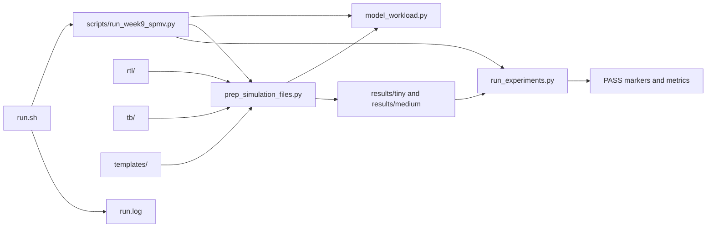

# Files and Usage

## Source files

| Path | Responsibility | How it is used |
| --- | --- | --- |
| `config/default.env` | Bash exports for project paths and the Python interpreter | Sourced and hashed by `run.sh` |
| `run.sh` | Execute the reproduction flow and capture commands/output | `bash run.sh` |
| `scripts/run_week9_spmv.py` | Parse CLI options and dispatch generation, self-tests, and simulations | Run directly with the course Python |
| `scripts/model_workload.py` | Pack/unpack commands, model execution, generate workloads | Used by generation and self-tests |
| `scripts/prep_simulation_files.py` | Write binary streams, memory images, traces, and manifests | Handles `--make` and copies RTL/templates |
| `scripts/run_experiments.py` | Build/run RTL tests, launch DRAM replays, calculate intensity | Handles simulator and analysis flags |
| `rtl/week9_spmv_axis.sv` | Synthesizable signed-integer streaming engine | Compiled by Verilator |
| `tb/tb_week9_spmv_axis.sv` | Tiny fixed-oracle testbench | Used by `--verilator` |
| `tb/tb_week9_file.sv` | File-driven oracle and backpressure testbench | Used by `--verilator-full` |
| `templates/week9_ramulator_ddr3.py` | Replay a trace and export genuine DRAM counters | Launched by Ramulator CLI operations |
| `.editorconfig`, `.clang-format` | Specify four-space Python/C++ indentation | Used by compatible editors/formatters |
| `handout.pdf` | Lab requirements and interpretation boundaries | Read alongside the generated evidence |



## Running the lab

From the project directory:

```bash
$ bash run.sh
```

`run.sh` resolves its own directory, then sources `config/default.env` through
the command logger. This Bash configuration exports `ROOT`, `PY`, and `W9`.
`ROOT` uses the detected directory and ignores an inherited `ROOT`; `W9` points
to the local entry point. `run.log` and `results/` therefore remain in the checkout. The compiler
and default Python paths identify shared course tools, not output directories.
Set `PY` explicitly if using another interpreter with the required bindings;
the configuration preserves a nonempty override. The configuration file is
included in the source hashes recorded in `run.log`.

The log is overwritten on each run. Commands begin with `$ `, followed by one
blank line and merged stdout/stderr. Three blank lines separate command entries.
A failed command stops the flow. Reproduction also rewrites workload files and
may rebuild simulator artifacts.

## Individual Python operations

These commands assume the compiler environment has been enabled and are run
from the project directory. They execute directly without the runner's logging.

```bash
$ source /opt/rh/gcc-toolset-13/enable
$ PY=/home/asinha/tools/week8/venv/bin/python
$ "$PY" scripts/run_week9_spmv.py --help
$ "$PY" scripts/run_week9_spmv.py --selftest
$ "$PY" scripts/run_week9_spmv.py --make --tiny --out results/tiny
$ "$PY" scripts/run_week9_spmv.py --make --rows 1024 --nnz-per-row 8 --cols 4096 --pattern scattered --tile 2048 --out results/medium
```

After generation:

| Operation | Command |
| --- | --- |
| DRAM hierarchy | `"$PY" scripts/run_week9_spmv.py --dram-hierarchy --out results/medium` |
| Intensity proxy | `"$PY" scripts/run_week9_spmv.py --roofline --out results/medium` |
| Tiny RTL | `"$PY" scripts/run_week9_spmv.py --verilator --out results/tiny` |
| Full RTL | `"$PY" scripts/run_week9_spmv.py --verilator-full --out results/medium` |
| Tiled-DMA replay | `"$PY" scripts/run_week9_spmv.py --ramulator --out results/medium` |

Without `--out`, the CLI uses the detected project's `results/medium/`.
An explicit relative `--out` is resolved against the caller's working directory.
Use `--out results/tiny` consistently for tiny generation and testing.

## Generated artifacts

Generated files are grouped within each workload directory:

| Directory or file | Purpose |
| --- | --- |
| `w9_manifest.json` | Workload metadata and relative-path hashes |
| `inputs/` | Binary commands, expected `y`, and `.memh` test inputs |
| `sources/` | Copied RTL, testbenches, and DDR3 replay template |
| `traces/` | Synthetic `.ldst` memory requests |
| `build/` | Verilator build for the selected test |
| `reports/dram_stats/` | Raw DRAM statistics and extracted metrics |
| `reports/w9_roofline_intensity_proxy.json` | Integer arithmetic-intensity report |

Each `--out` directory is a workload root. Its manifest stays at the top level;
inputs, copied sources, traces, builds, and reports have separate groups:

```text
results/
├── tiny/
│   ├── w9_manifest.json
│   ├── inputs/
│   ├── sources/
│   ├── traces/
│   ├── build/
│   └── reports/
│       ├── dram_stats/
│       └── w9_roofline_intensity_proxy.json
└── medium/
    ├── w9_manifest.json
    ├── inputs/
    ├── sources/
    ├── traces/
    ├── build/
    └── reports/
        ├── dram_stats/
        └── w9_roofline_intensity_proxy.json
```

Build directories appear only when their corresponding RTL tests run. Report
directories may remain empty until their experiment runs. All paths below except
`run.log` are relative to the workload root.

| Artifact | Contents / consumer |
| --- | --- |
| Project `run.log` | Commands, merged output, source hashes, tool versions, and PASS markers |
| `w9_manifest.json` | Dimensions, counts, model budget, and hashes keyed by relative data paths |
| `inputs/dma_commands.bin`, `inputs/cmds.memh` | Same commands as packed 64-bit words and hexadecimal text |
| `inputs/expected_y.bin`, `inputs/expected.memh` | Signed 32-bit oracle for `y` as binary and hexadecimal text |
| `traces/tiled_dma_16B.ldst` | Synthetic contiguous command reads and result writes |
| `traces/w9_dram_sequential_16B.ldst` | Sequential-read microbenchmark |
| `traces/w9_dram_strided_16B.ldst` | Strided-read microbenchmark |
| `reports/dram_stats/*.ramulator_stats.yaml` | Raw statistics for each trace |
| `reports/dram_stats/*.ramulator_metrics.json` | Extracted controller metrics and request accounting |
| `reports/w9_roofline_intensity_proxy.json` | INTOP/DMA-byte calculation and excluded costs |
| `sources/` | Copied RTL, testbenches, and the DDR3 replay configuration |
| `build/` | Disposable Verilator compilation products |

The full RTL test runs with `inputs/` as its working directory, allowing the
unchanged `$readmemh` filenames to resolve correctly. Compilation uses absolute
paths to the copies under `sources/`.

The Ramulator template accepts a positional trace and optional `--report-dir`:

```bash
$ "$PY" results/medium/sources/week9_ramulator_ddr3.py results/medium/traces/tiled_dma_16B.ldst --report-dir results/medium/reports/dram_stats
```

The experiment runner always supplies the grouped report directory. Direct
replay without `--report-dir` writes reports beside the trace, preserving the
standalone interface.

Modify sources in `rtl/`, `tb/`, `templates/`, or `scripts/`, then regenerate the
workload. Generated copies and Verilator build products are overwritten by
subsequent generation/build operations.

## Provenance and measurement scope

The project was split from the instructor's Fix 2 generator, whose original
single-file SHA-256 is
`2614b191ba74744f400ba247a45e2545d37d2e672f5c3aed0f7263e1b9cd3e26`.
That checksum does not apply to this refactored tree. The runner records current
source hashes instead. Documentation and formatting changes also alter the
copied source bytes.

RTL simulation and DRAM controller replay have distinct measurement boundaries.
CPU profiling and CPU preprocessing measurements are outside this project. Physical PYNQ deployment, Vivado timing/resource reports,
and measured board speedups require separate validation.
