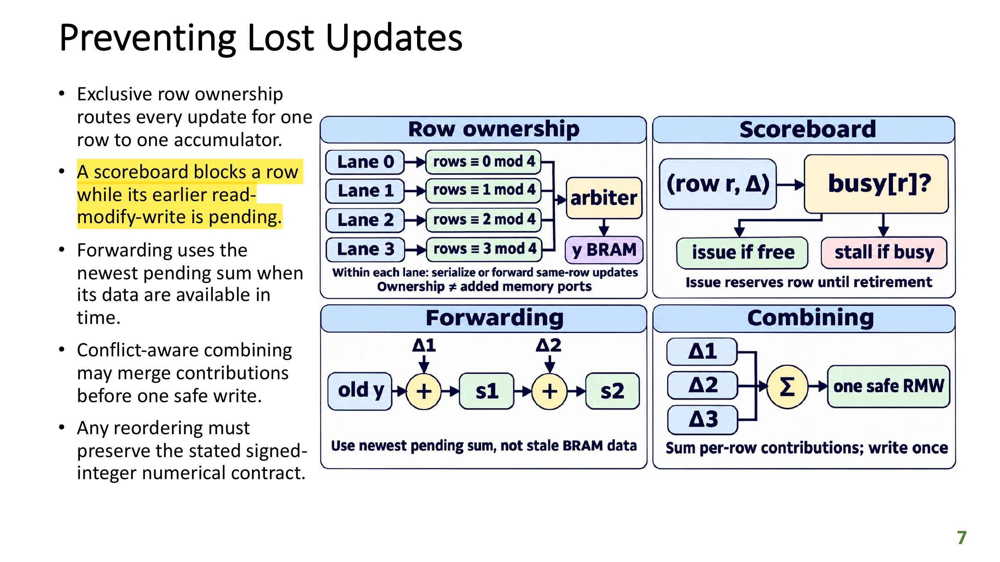
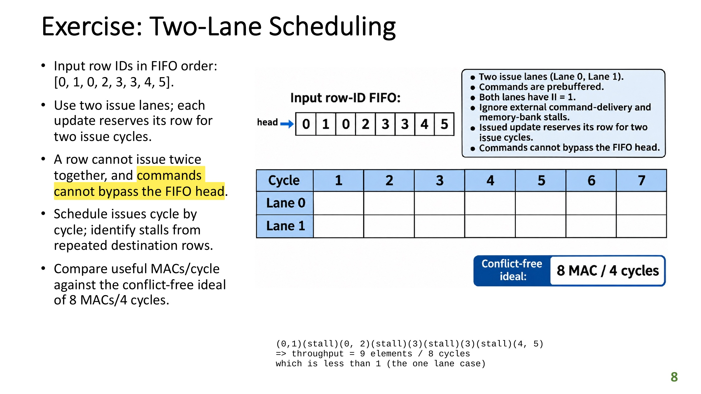

# Project 7.1 Dual-Issue MAC Scheduling with Row Hazards and Bank Conflicts

## 1. Introduction

This lab implements a dual-issue MAC scheduler. Two MAC lanes can accept two commands in one cycle when their destination rows are available and their banks differ. Scheduling protects the output accumulators from overlapping updates to the same row and prevents two commands from using the same bank in one cycle.

In this lab, you’ll learn how a scheduler issues up to two MAC commands per cycle while preserving FIFO order and reserving recently issued rows. By tracing the Verilator tests cycle by cycle, you’ll observe when a row hazard blocks both lanes, when a bank conflict allows only one lane to issue, and how gaps in command availability reduce throughput without increasing either conflict counter.

## 2. Reproduction Flow

```bash
$ bash run.sh
```

## 3. RTL Design

<p>
    
    
</p>

In each cycle:

1. **Peek at the FIFO.** `head_row0` is the oldest command’s destination row and `head_row1` is the next command’s row. The corresponding bits of `head_valid` indicate which entries are available. Head 1 is available only when head 0 is available.
2. **Check head 0 first.** If its row is free, the scheduler issues it on lane 0. If its row is busy, both commands wait because strict FIFO order prevents head 1 from bypassing head 0.
3. **Check whether head 1 can join.** After head 0 qualifies, an available head 1 must target a free row distinct from head 0’s row. It must also use a different bank. The lab models two banks with one issue-stage access each per cycle. Even rows use bank 0 and odd rows use bank 1.
4. **Report the decision and update state.** Each set bit in `issue_valid` identifies an active lane, and `issue_row0` or `issue_row1` carries its destination. `pop_count` tells the FIFO how many commands to consume. On the rising edge, `busy_rows` is replaced with the rows just issued, so each row is reserved for the following cycle and becomes eligible again one cycle later.

For the trace starting with `[0, 1, 0, 2]`, cycle 0 issues rows 0 and 1 together. Cycle 1 presents rows 0 and 2, but row 0 is still busy, so both wait. In cycle 2, row 0 is free and issues alone because row 2 shares its even bank.

`issued_total` adds `pop_count` each cycle. `row_hazard_cycles` and `bank_conflict_cycles` each count cycles with the corresponding blocking event, including cycles when lane 0 still issues. If both rules could block head 1, the scheduler counts a row hazard. When neither head is available, `pop_count` is zero and neither event counter increments. Synchronous reset clears the scoreboard and all three counters.

## 4. Verification

The testbench checks issue decisions, row reservations, and counters cycle by cycle.

| Test | Input rows | Behavior checked |
| --- | --- | --- |
| `slide8_combined` | `[0, 1, 0, 2, 3, 3, 4, 5]` | FIFO ordering, row hazards, and bank conflicts |
| `same_bank_rows` | `[0, 2, 4, 6, 8, 10]` | Distinct rows in the same bank issue one at a time |
| `repeated_row` | `[3, 3, 3, 3]` | Same-cycle duplicate prevention and next-cycle reservation |
| `source_gaps` | `[0, 1, 2, 3, 0, 4, 5, 6]` | Both FIFO heads are unavailable on cycles 2 and 5, counting from zero |

## 5. Results

All four directed tests passed in [run.log](run.log)

| Test | Cycles | MACs issued | Row-stall cycles | Bank-conflict cycles |
| --- | ---: | ---: | ---: | ---: |
| `slide8_combined` | 7 | 8 | 2 | 1 |
| `same_bank_rows` | 6 | 6 | 0 | 5 |
| `repeated_row` | 7 | 4 | 6 | 0 |
| `source_gaps` | 7 | 8 | 0 | 1 |

- **`slide8_combined`** issued 8 MACs in 7 cycles. Two row hazards blocked both lanes, and one bank conflict blocked only lane 1.
- **`same_bank_rows`** sustained one MAC per cycle. The first five cycles exposed two even rows, so lane 1 waited each time. The final cycle had one command left.
- **`repeated_row`** issued row 3 every other cycle. The six row-hazard events came from three cycles when both lanes waited and three cycles when lane 0 issued but the duplicate row could not issue on lane 1.
- **`source_gaps`** issued 8 MACs in 7 cycles. The two empty-input cycles counted toward elapsed time and left both conflict counters unchanged. The one bank conflict occurred when rows 0 and 4 were both available.

## 6. Conclusion

The two lanes give the scheduler a peak issue rate of two MACs per cycle. The slide 8 trace averages about 1.14 MACs per cycle because row reservations sometimes block the FIFO head and a bank conflict prevents one pair from issuing together. The all-even trace averages one MAC per cycle because every command uses the same bank. The repeated-row trace averages about 0.57 because each update must wait for the previous reservation to expire.

Forwarding an updated accumulator value or combining contributions to the same row could reduce repeated-row stalls. More independent bank access capacity or a bank mapping that spreads active rows across banks could reduce bank conflicts. A deeper prefetch buffer could absorb temporary gaps in command delivery when commands have arrived ahead of time.
