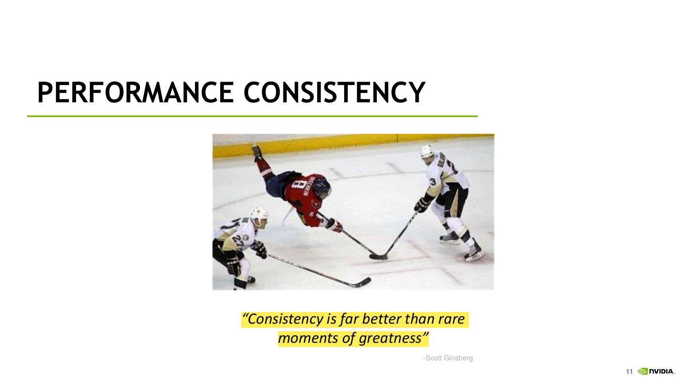
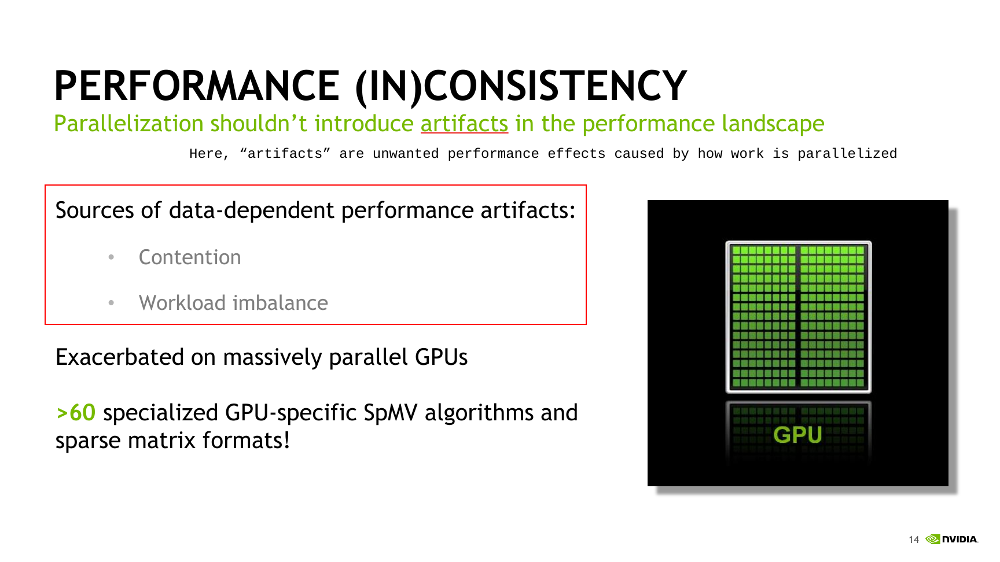
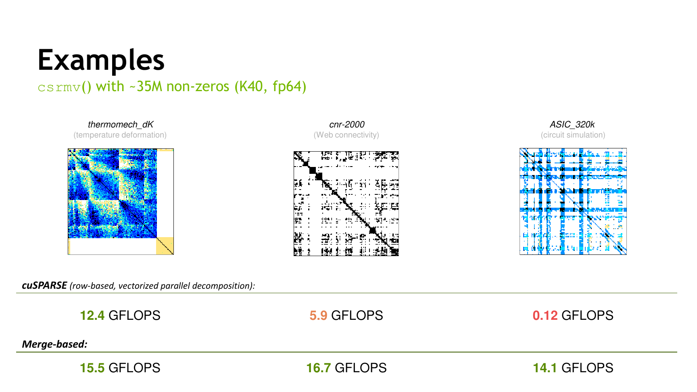
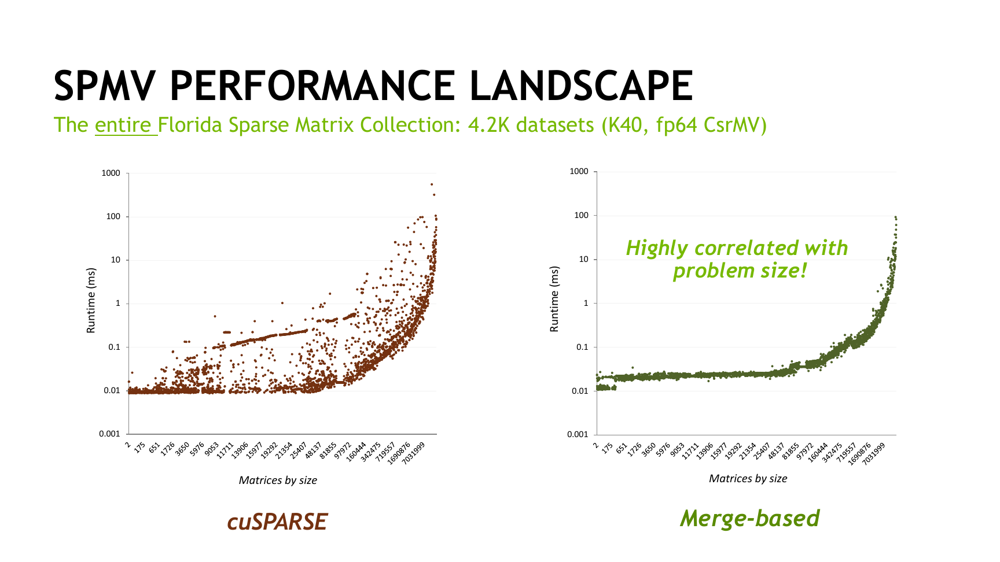
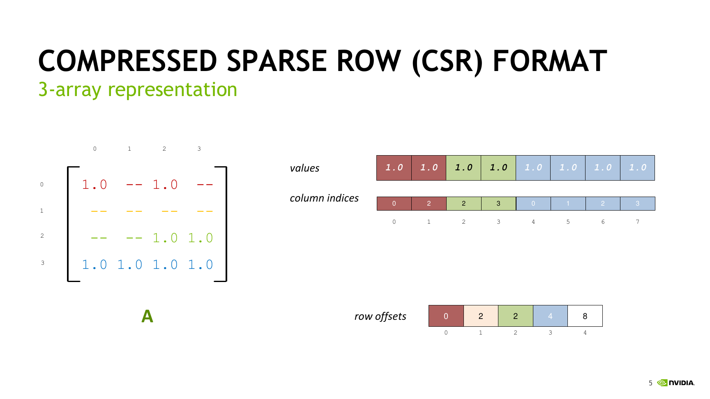
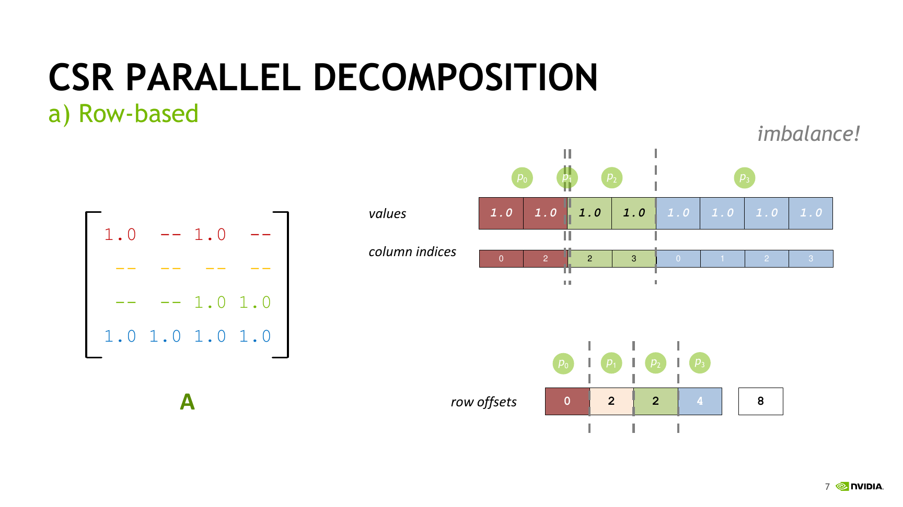
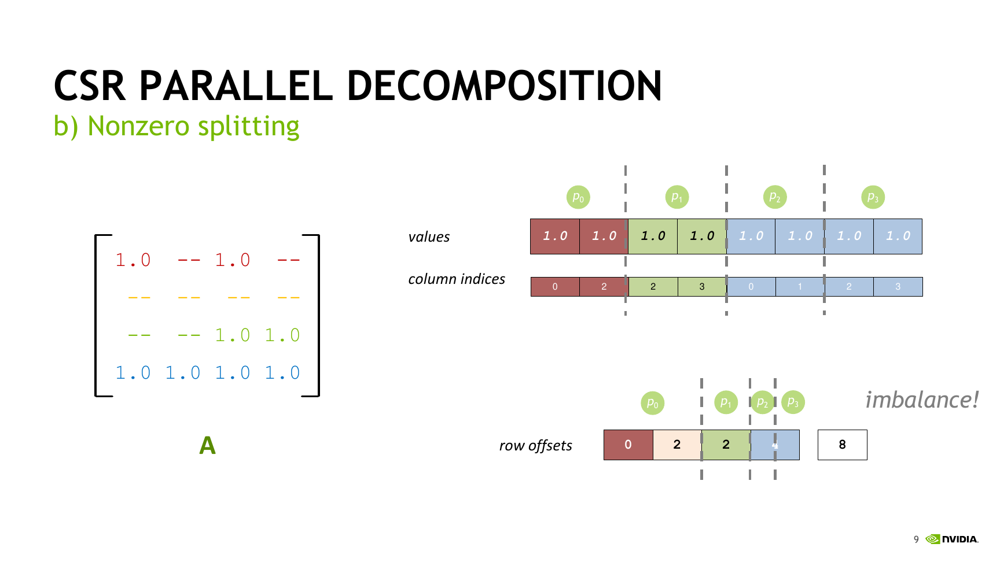
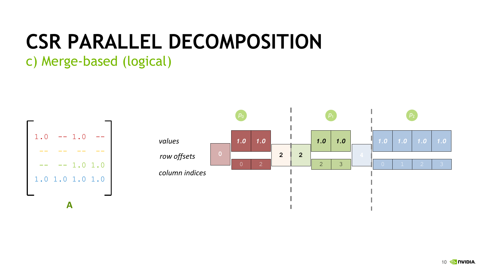
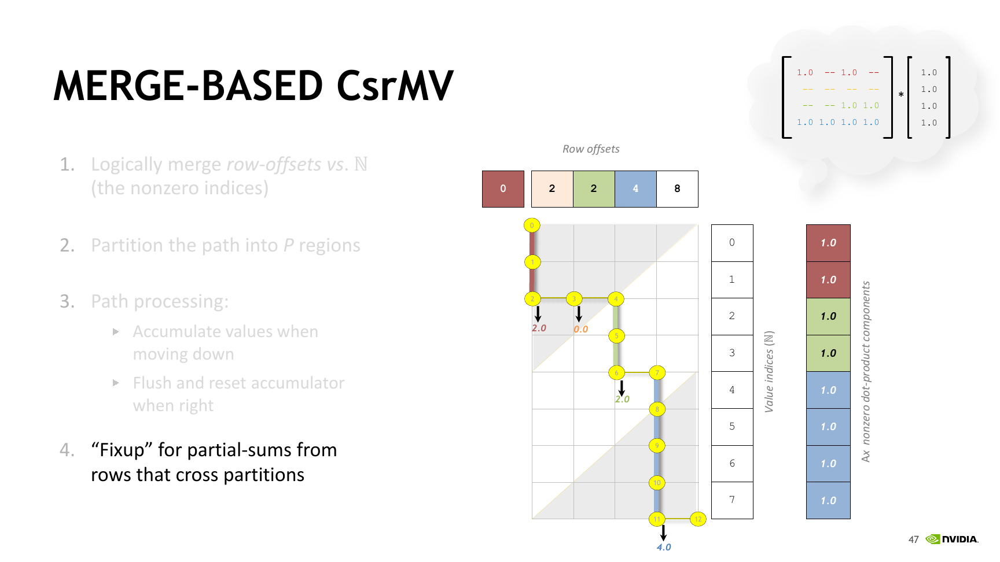
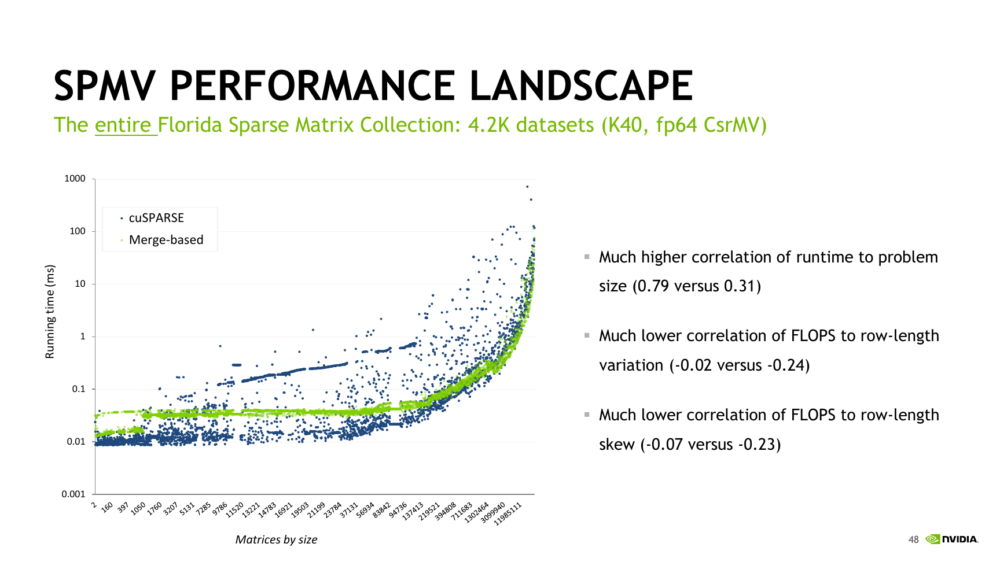

# W11-2. CSR SpMV: Worker Load Balancing across Partitioning Schemes

## 1. Introduction

In his [NVIDIA Research presentation on merge-based SpMV](NVDA-Merge-Based-Parallel-SpMV-Merrill.pdf), Duane Merrill examines why sparse matrix–vector multiplication can have widely different GPU runtimes for matrices of similar size. SpMV computes `y = Ax` using the stored nonzeros of `A`. When those nonzeros are concentrated in a few rows, workers assigned the same number of rows can end up doing very different amounts of arithmetic. Merrill presents merge-based partitioning as a way to distribute that work more evenly. [[1]](#reference-1)

Load balancing helps a parallel system scale by keeping workers busy and reducing the time spent waiting for the worker with the heaviest partition. As more workers are added, uneven partitions can limit the speedup even when extra compute capacity is available. The [Week 11 worksheet](Week11_Case_Study.pdf) compares three CSR partitioning schemes and asks how their tradeoffs apply to a two-lane FPGA accelerator.

## 2. Performance Consistency

  
  

Across roughly 4,200 matrices on a K40 GPU, merge-based SpMV showed stronger runtime correlation with problem size than cuSPARSE (0.79 vs. 0.31) and weaker throughput correlation with row-length variation (−0.02 vs. −0.24). Uneven rows and irregular accesses to `x` can affect runtime (slides 14–16, 48).

  
  

## 3. Partitioning Schemes

  
  
  
  

The three schemes divide CSR SpMV work among parallel workers by rows, by nonzeros, or by counting both. The table compares how each scheme balances work and handles rows that span partitions (slides 6–10).

| Scheme | What each worker gets | Tradeoff |
| --- | --- | --- |
| Row-based | Roughly equal numbers of whole rows | Each row has one owner, but long rows can leave other workers idle. |
| Nonzero splitting | Roughly equal numbers of nonzeros | Balances multiply-adds, but workers can cross different numbers of row boundaries and need to combine split-row sums. |
| Merge-based | Equal-length segments of a path that counts nonzeros and row boundaries | Balances the combined work but requires a fixup for split rows. |

## 4. Merge-Based CSR Partitioning

  
  

The algorithm balances the total number of nonzero and row-boundary steps assigned to each worker (slides 35–36 and 43–47).

| Step | How it works |
| --- | --- |
| 1. Define the merge path | Logically merge CSR row-end offsets with nonzero indices. A path step either advances to the next nonzero or crosses a row boundary. |
| 2. Find partition boundaries | Divide the path into as many nearly equal segments as there are workers. Each worker searches along a diagonal of the merge grid to find its starting position. |
| 3. Process each segment | For each nonzero, multiply its value by the corresponding entry of `x` and accumulate the product. At a row boundary, emit the accumulated sum and reset the accumulator. |
| 4. Combine split-row sums | If a row crosses a partition boundary, add the partial sums for that row to produce its final entry in `y`. |

## 5. Results

  

NVIDIA tested double-precision CSR SpMV on a K40 GPU across roughly 4,200 matrices. In slide 48, runtime correlated more strongly with problem size for merge-based SpMV (0.79) than for cuSPARSE (0.31), so matrix size was a better predictor of runtime in this benchmark.

Throughput had a weaker relationship with both row-length variation (−0.02 vs. −0.24) and row-length skew (−0.07 vs. −0.23). The correlations closer to zero indicate that throughput was less tied to how uneven the row lengths were. These coefficients describe how the measured quantities vary together. Use the plotted runtimes to compare speed for a given matrix.

## 6. FPGA Design Implications

For the two-lane FPGA, a partitioning scheme is worth adopting if it reduces total cycles after accounting for stalls and partial-sum overhead.

- **Balance the work that costs cycles.** NVIDIA’s merge path counts both nonzeros and row boundaries. On the FPGA, multiply-adds, row transitions, and memory stalls can have different costs. The command input accepts at most one command per cycle, bank conflicts can delay operand reads or result writes, and the row-hazard scoreboard can stall updates to the same output row. These limits determine how much concurrency the two lanes can sustain.
- **Split rows when the idle-cycle savings justify the reduction.** Whole-row ownership simplifies accumulation and writeback. Sharing a long row can keep both lanes busy, but the accelerator must retain and combine the partial sums before writing the final output. The benefit depends on how much idle time the split eliminates and how many cycles it adds for partial-sum handling.

**NVIDIA Research’s merge-based scheme** brings both tradeoffs into the hardware–software design. The host could search the merge path and send partition boundaries with the work commands. That adds host setup and command traffic, but the boundaries can be reused when the sparsity pattern and lane count stay fixed. Computing the boundaries on the FPGA instead saves those transfers but requires search logic and CSR row-offset reads. In either design, the lanes still need to combine partial sums for split rows. The benefit depends on whether the saved idle cycles outweigh boundary setup and reduction, and whether the command interface and memory banks can keep both lanes supplied.

Measure end-to-end cycles, lane utilization, and stalls from command supply, bank conflicts, and row hazards.

## 7. Conclusion

In NVIDIA’s GPU measurements, runtime tracked problem size more closely with merge-based partitioning, and throughput was less sensitive to variation in row length. Counting both nonzeros and row boundaries gives workers a more even share of the arithmetic and row-processing work. The tradeoff is extra work at partition boundaries, where partial sums from a split row must be combined before writing the final result.

NVIDIA’s results show why workload balance matters for GPU scalability. As more workers share a sparse matrix, a few overloaded workers can still determine when the computation finishes. Accounting for both nonzeros and row boundaries helps distribute that work and makes performance less sensitive to uneven row lengths. For future GPU SpMV designs, evaluate partitioning across a range of matrix sizes, row-length distributions, and worker counts, and report both speedup and runtime consistency.

## References

[[1] Duane Merrill and Michael Garland. 2016. Merge-based parallel sparse matrix-vector multiplication. In Proceedings of the International Conference for High Performance Computing, Networking, Storage and Analysis (SC '16). IEEE Press, Article 58, 1–12.](https://dl.acm.org/doi/10.5555/3014904.3014982)
